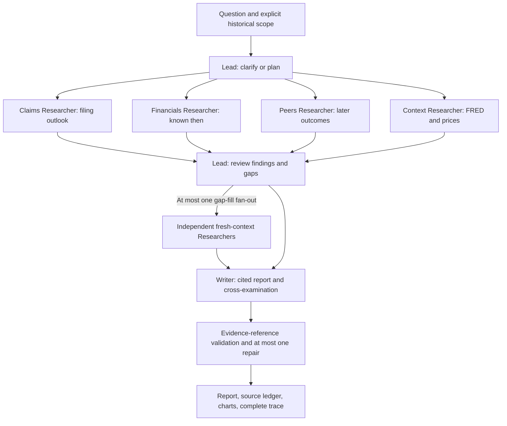

# The Receipts

**They said it. Did they deliver?** The Receipts is a historical financial investigation desk for investors and traders. It compares management outlook passages with subsequent reported financial results and puts the company beside its industry peers. Every investigation exposes the evidence and the agent/tool trace.

**Live application:** https://the-receipts-7l4zrnepoq-ue.a.run.app

**Author:** Aditya Pendyala, ap4839@columbia.edu · **IEOR 4570 Project 2:** `research` (Deep Research).

## Use the application

1. Ask a historical financial question in the main bar, naming the company and any peers.
2. Press **Enter** or the green submit button to investigate directly. **Shift+Enter** adds a line. The optional **Research lens** controls sit beneath the bar; the date summary shows the default historical scope.
3. Optionally open **Compare companies or change dates** to add up to two peers, adjust the three dates, or browse source data without an AI answer. The bundled examples use **2020-01-01 / 2023-03-01 / 2025-03-01**.
4. Results open with a short finding and key financial figures. Expand claim checks, performance charts, the full report, market context or limitations only when needed.
5. Select a numbered citation to inspect its source. **Sources** and **Research log** preserve the evidence ledger and full agent/tool trace. **Download** exports the complete case as JSON.

The public-facing interface uses progressive disclosure, plain language, labeled inputs, keyboard-native controls and touch-sized actions. Company, question and one primary action form the starting screen; optional setup and detailed research are collapsed. Example investigations are compact suggestions rather than separate landing-page sections.

The interface explains the audience, workflow, data boundaries and difference between evidence preview and AI investigation. It renders model text as text nodes, with server-validated evidence references linked to the ledger. Model-generated HTML is never injected.

## Research architecture



There are three distinct agent shapes: Lead, Researcher and Writer. Four specialized Researchers fan out concurrently in a `ThreadPoolExecutor` from one Lead planning turn. Each receives only its task, scoped tool menu and its own tool results. A Researcher never receives another Researcher's conversation. A gap-fill Researcher also starts with a fresh context.

Researchers choose structured tool requests; the server validates the tool name and scoped ticker, supplies the date boundaries, executes the public-data adapter, and returns evidence to that Researcher's next model turn. No agent can fetch arbitrary URLs or widen the server's historical scope. The Lead reviews findings, recorded source calls and failures, then can dispatch up to two missing-source tasks in one additional parallel round. Finally, the Writer receives the assembled ledger and arithmetic changes/range checks. A fresh Writer editing pass checks factual consistency before reference validation. The opening summary is assembled deterministically from reported annual observations and explicit quoted-range calculations; free-form interpretation remains in the cited sections.

Bounds: **2 research rounds**, **3 decision turns per Researcher**, **22 distinct source tool calls**, one Writer factual-editing pass and one citation-repair attempt, and a **240-second model/research budget**. Individual source HTTP requests time out at 18 seconds; model requests at 38 seconds or the remaining budget. A slow in-flight source request may run past the soft research budget; Cloud Run has a 300-second request timeout. At most two user investigations run simultaneously in one instance. These are application controls, not distributed rate limits or a hard billing cap.

When required company/date information is absent, the Lead asks for clarification before calling any source tool. Explicit frontend scope overrides model-inferred scope. Source failures are recorded as gaps. The Writer must acknowledge missing evidence; a failed model request or citation gate returns an explicit unavailable result with collected evidence, never a fabricated report.

Citation validation checks evidence existence, rejects unknown references and generated URLs; a gap reference can support only an explicit statement about missing evidence, normalizes grouped references, and requires actual management passages for claim receipts. It also requires same-company outcomes for testable receipts, a compatible financial metric, and a financial period ending after the management statement. The historical-knowledge section cannot cite later filings or revised market/macro context. A claim card without outcomes is conservatively marked not testable; an overall claim verdict without any testable receipts becomes insufficient evidence. It does **not** prove semantic entailment of every sentence or automatically guarantee that two accounting definitions match. Inspect the primary sources. Qualitative, segment-specific, operational or undated promises may remain **not testable** with entity-wide annual financial data.

### Project 1 API compatibility

`POST /chat` still accepts `message` and optional `session_id`, and returns the original fields:

```json
{
  "response": "A cited Markdown investigation or a clarification",
  "session_id": "a UUID",
  "tool_calls": [
    {"agent": "Claims", "name": "claims", "args": {}, "result": "JSON string", "elapsed_ms": 123}
  ],
  "investigation": {"status": "complete", "scope": {}, "report": {}, "evidence": [], "limits": [], "rounds": 1}
}
```

`scope` is an optional request extension: `{"tickers":["TSLA","GM","F"],"start":"2020-01-01","as_of":"2023-03-01","through":"2025-03-01"}`. The extra `investigation` response field powers the interface; the original `response`, `session_id`, `tool_calls`, and string-valued `result` contract remains intact. **Every model stage and every sub-agent source call includes `agent`.** `POST /evidence` returns the same shape with `status=preview` and no model verdict. `POST /clear` accepts `session_id`. `GET /health` is service liveness, not a claim that model credentials work. `GET /catalog` lists starter industries and bounds.

Sessions retain only the previous scope and question, not entire prior reports. An unscoped follow-up may reuse that scope; answers are researched afresh. Sessions are isolated by random UUID, expire after 30 minutes idle, are capped at 100, and disappear on restart. This is a course application, not durable portfolio storage. The browser stores the session ID in tab-scoped `sessionStorage`.

## Data sources and reproducibility

This solo project uses **three source families**, exceeding the one-data-source-per-team-member requirement. There are no paid financial-data services or third-party paid model APIs. Gemini requests use the named GCP project and its existing Vertex AI access.

| Source | Data and access | Interpretation |
|---|---|---|
| [SEC EDGAR](https://www.sec.gov/search-filings/edgar-application-programming-interfaces) | Keyless submissions JSON, archived annual/quarterly filing HTML and Company Facts XBRL | Management excerpts and annual entity financials; exact filing/accession and XBRL tag retained |
| [FRED](https://fred.stlouisfed.org/) | Keyless graph CSV for `FEDFUNDS` and `CPIAUCSL` | Macro context. Current revised history; **not** an ALFRED real-time vintage |
| [Yahoo Finance historical prices](https://finance.yahoo.com/quote/TSLA/history/) | Keyless, unofficial chart endpoint, `indicators.adjclose` | Best-effort vendor-adjusted daily closing history. No live quote, execution price or causal inference |

The runtime source-text cache is capped at 64 million characters and 160 URLs. The source loader archives original UTF-8 source bodies with retrieval time, original URL and SHA-256. About 11 MB of gzip archives in `data/snapshots/` ship with the deployment; `data/manifest.json` records coverage. A snapshot is fetched **at archive time**, not at the historical cutoff. The app separately filters SEC records by actual filing date. Source hashes are checked before archives are used. No credentials are stored with the data.

Bundled starter universes:

- Automakers: Tesla (`TSLA`), General Motors (`GM`), Ford (`F`).
- Semiconductors: NVIDIA (`NVDA`), AMD (`AMD`), Intel (`INTC`).
- Cloud platforms: Microsoft (`MSFT`), Amazon (`AMZN`), Alphabet (`GOOGL`).

These are curated peer groups, not exhaustive industry universes, and membership is contemporary. They are subject to survivorship and selection bias. Other tickers resolve through the SEC's current ticker directory. Foreign/private companies, delisted-company discovery and complete historical industry membership are outside this version.

### Load the data

```bash
uv sync --locked
uv run python -m scripts.load_data
```

The loader gets each company's Company Facts and price history, filing submissions and up to three recent filings for each demo company, plus the two macro series. It preserves existing matching archives. To refresh a specific source, remove its archive from `data/snapshots/` and rerun the loader; keep the prior archive elsewhere if reproducibility matters. Each filename is the SHA-256 of the source URL. Live fetches use an in-process cache, while the loader explicitly persists archives. Set `OFFLINE_DATA=1` to require bundled data and return explicit gaps elsewhere.

Endpoint patterns:

```text
https://data.sec.gov/submissions/CIK##########.json
https://data.sec.gov/submissions/CIK##########-submissions-NNN.json
https://data.sec.gov/api/xbrl/companyfacts/CIK##########.json
https://www.sec.gov/Archives/edgar/data/{cik}/{accession_without_dashes}/{primaryDocument}
https://fred.stlouisfed.org/graph/fredgraph.csv?id={series}&cosd={start}&coed={end}
https://query1.finance.yahoo.com/v8/finance/chart/{ticker}?period1={unix_start}&period2={exclusive_unix_end}&interval=1d
```

The SEC User-Agent identifies this academic project and its author's contact email. A shared process adapter paces SEC request starts at less than five per second; one Cloud Run instance is configured. A block, invalid response, missing adjusted close or missing series becomes an explicit evidence gap. No raw-close or invented financial fallback is substituted.

### Accounting and historical boundaries

Financial facts must be USD, from annual 10-K/10-K/A filings, with duration **330–380 days**. YTD, quarterly and instant values are excluded. Only facts filed on or before the requested availability date are eligible. For each period the adapter takes the earliest filed observation, breaking ties using a documented tag preference. This preserves original-reported observations instead of silently replacing them with later restatements. Historical SEC facts cannot enter the known-then room merely because their fiscal period ended before the cutoff.

Total `Revenues` takes precedence over contract revenue where both are reported, particularly for automakers with financing businesses. Revenue fallback concepts and capex definitions can still differ; the exact tag is exposed in the ledger. Cash capex uses `PaymentsToAcquirePropertyPlantAndEquipment`. No segment aggregation, quarter derivation, inflation adjustment, GAAP reconciliation or currency conversion is inferred. NVIDIA and Microsoft fiscal-year ends differ from calendar-year peers. Future filings, later restatements, revised FRED series and retrospectively adjusted stock prices cannot support a statement about what investors knew at the cutoff.

Management passages are a ranked, bounded retrieval from at most three latest 10-K/10-Q filings in the selected range. It is a sentence-level normalized excerpt search for forward-looking language, not an exhaustive earnings-call archive, semantic search across all exhibits or proof that no other guidance existed. The UI exposes the exact excerpt and a find-in-filing locator. Only explicitly retrieved passages can become claim receipts.

## Three grader questions and model-only comparisons

All use `start=2020-01-01`, `as_of=2023-03-01`, `through=2025-03-01`. Exact run outputs, complete traces and same-model baselines are in `evaluations/`. Baselines receive the same question and dates with **no system prompt and no tools**, using the same Gemini model as the application. Model-only responses are recorded observations, not gold answers.

1. **Automakers:** “Did Tesla's growth expectations hold up after 2022? Cross-examine the evidence and compare annual revenue and profitability with GM and Ford.” Expected: distinguish company revenue growth from vehicle-delivery targets; identify any testable capex outlook separately; Tesla annual revenue was $81.462B in 2022 and $97.690B in 2024. GM's 2024 total `Revenues` was $187.442B; do not mistake its $171.606B contract revenue for the whole company. Source: SEC Company Facts for CIK `0001318605`, `0001467858`, `0000037996`, and management passages in the archived filings. The outcome cannot prove intent.
2. **Semiconductors:** “As of March 1, 2023, what did NVIDIA expect, and how did annual revenue and operating income subsequently compare with AMD and Intel through March 1, 2025?” Expected: retrieve original outlook passages, distinguish NVIDIA fiscal years from calendar years, compare date-bounded original annual observations, and avoid injecting later AI narratives into the historical room. Expected numeric anchors: NVIDIA revenue was $26.974B in FY2023 (ended January 29, 2023), $60.922B in FY2024 (ended January 28, 2024), and $130.497B in FY2025 (ended January 26, 2025). Source: Company Facts for CIK `0001045810`, `0000002488`, `0000050863` and NVIDIA filings. Verify numeric answers against the ledger rather than an unqualified calendar-year label.
3. **Cloud platforms:** “Compare management growth and investment expectations with later annual revenue and capital expenditures for Microsoft, Amazon and Alphabet. Which claims can the data actually test?” Expected: identify Microsoft's historical expectation that capital expenditures would increase to support cloud growth, compare subsequent annual cash PP&E purchases, and explain that consolidated financials cannot directly establish cloud-segment promises. Expected numeric anchors: Microsoft cash PP&E purchases were $23.886B in FY2022, $28.107B in FY2023 and $44.477B in FY2024. Amazon has no supported annual cash-PP&E tag in the selected window; its revenue cannot validate an infrastructure-spending promise. Source: Company Facts for CIK `0000789019`, `0001018724`, `0001652044` and Microsoft 10-Q/10-K outlook passages.

### Recorded answers from the final validation runs

These are actual Gemini runs, not illustrative transcripts. Full model/tool traces are retained in the linked JSON files. The opening agent summary uses the final deterministic arithmetic policy applied to the recorded evidence.

| Case | Research status | Research latency | Trace |
|---|---|---:|---|
| automakers | complete | 70.0 s | [Full trace](evaluations/automakers.json) |
| chips | complete | 69.74 s | [Full trace](evaluations/chips.json) |
| cloud | complete | 68.36 s | [Full trace](evaluations/cloud.json) |

#### Automakers: same-model comparison

<details>
<summary>No tools, no system prompt — complete recorded answer</summary>

To determine whether Tesla's growth expectations held up after 2022, we must cross-examine its operational metrics, financial trajectory, and market expectations against its legacy peers, General Motors (GM) and Ford Motor Company (F), covering the period from 2020 through the end of 2024. 

---

### Part 1: Did Tesla's Growth Expectations Hold Up After 2022?

Prior to and through 2022, Tesla operated under the explicit long-term guidance of achieving a **50% compound annual growth rate (CAGR)** in vehicle deliveries over a multi-year horizon. 

#### 1. The Delivery Growth Reality Check
* **Pre-2023 Execution:** Tesla largely delivered on its hyper-growth narrative. In 2021, deliveries grew by **87%** (to ~936k units), and in 2022, they grew by **40%** (to ~1.31 million units), coming close to the 50% target despite severe global supply chain disruptions and COVID-19 lockdowns in Shanghai.
* **Post-2022 Deceleration:** The 50% CAGR target broke down significantly after 2022:
  * **2023:** Tesla delivered ~1.81 million vehicles, representing a **38% YoY growth**—below the 50% target, achieved only through aggressive global price cuts that began in late 2022 and continued through 2023.
  * **2024:** Tesla delivered ~1.79 million vehicles (or roughly flat-to-modest growth depending on final reported classifications, representing a dramatic slowdown to **~1-2% YoY growth**). 
* **The Verdict on Expectations:** **No, the structural hyper-growth expectations did not hold up.** Tesla transitioned from a high-growth startup phase into a cyclical, mass-market auto manufacturer constrained by aging vehicle architectures, rising global EV competition (particularly from Chinese rivals like BYD), and consumer fatigue with high interest rates. By 2024, management officially abandoned the 50% multi-year delivery growth guidance.

---

### Part 2: Financial Comparison (TSLA vs. GM vs. F)

To assess the financial health underpinning these growth expectations, we examine annual revenue and profitability (Net Income and Operating Margins) from 2020 through 2024.

#### A. Annual Revenue (in USD Billions)

| Company | 2020 | 2021 | 2022 | 2023 | 2024 |
| :--- | :--- | :--- | :--- | :--- | :--- |
| **Tesla (TSLA)** | $31.54B | $53.82B | $81.46B | $96.77B | **$97.69B** |
| **General Motors (GM)** | $122.48B | $127.00B | $156.74B | $171.84B | **$171.86B** |
| **Ford (F)** | $127.14B | $136.34B | $158.10B | $176.19B | **$179.76B** |

* **Revenue Analysis:** 
  * **Tesla** experienced staggering top-line expansion between 2020 and 2022 (more than doubling revenue). However, post-2022, revenue growth hit a wall, rising by just ~18% in 2023 and flattening out near ~$97.7B in 2024 due to average selling price (ASP) declines driven by price cuts.
  * **GM and Ford** generate substantially more absolute revenue than Tesla (nearly double). Both legacy automakers saw steady post-pandemic revenue recovery through 2023, followed by top-line stabilization in 2024 as pricing power normalized across the industry.

#### B. Profitability: Net Income (in USD Billions)

| Company | 2020 | 2021 | 2022 | 2023 | 2024 |
| :--- | :--- | :--- | :--- | :--- | :--- |
| **Tesla (TSLA)** | $0.72B | $5.52B | $12.56B | $15.00B* | **$7.15B** |
| **General Motors (GM)** | $6.43B | $10.02B | $9.93B | $10.13B | **$3.60B** |
| **Ford (F)** | -$1.28B | $17.94B** | -1.98B | $4.35B | **$1.75B** |

*\*Note: Tesla's 2023 net income includes a massive one-time non-cash tax benefit of $5.9 billion. Without this, core operating earnings compressed severely.*  
*\*\*Note: Ford’s 2021 net income was heavily skewed by its equity stake valuation in Rivian.*

* **Profitability Analysis:**
  * **Tesla's Margin Compression:** Post-2022, Tesla's profitability narrative deteriorated. Operating margins, which peaked near industry-leading levels of ~16-17% in 2022, dropped toward the high single digits by 2023–2024 as price cuts squeezed gross automotive margins (excluding regulatory credits). In 2024, net income was slashed by more than half compared to 2023 levels.
  * **Legacy Volatility:** GM and Ford maintained steady profitability through 2023 fueled by robust internal combustion engine (ICE) truck and SUV sales. However, both experienced margin hits in 2024 due to high warranty costs, labor contract wage increases (post-UAW strikes), and heavy operating losses in their dedicated EV divisions (Ford's *Model e* segment lost billions annually).

---

### Summary Conclusion

1. **Did Tesla's growth expectations hold up?** **No.** While Tesla remains the undisputed leader in Western EV adoption, the post-2022 era exposed the limits of its demand curve at previous price points. Delivery growth stalled significantly in 2023 and flatlined in 2024, forcing the company to pivot its narrative toward autonomous driving (FSD), AI, and robotics to justify its valuation.
2. **Financial Comparison:** 
   * **Scale:** GM and Ford vastly outperform Tesla in total annual revenue, moving nearly double the volume of vehicles globally.
   * **Earnings Quality:** While Tesla historically enjoyed superior software-like operating margins, the post-2022 price wars compressed Tesla's profitability down closer to traditional automotive norms, while legacy automakers absorbed multi-billion-dollar losses attempting to scale their own EV portfolios.

</details>

<details>
<summary>The Receipts — complete evidence-based answer</summary>

# Tesla Growth Expectations and Peer Comparison Post-2022

**Mixed**

TSLA revenue for the fiscal period ended 2024-12-31 was $97.690 billion [E06fb99d6f5](https://www.sec.gov/Archives/edgar/data/1318605/000162828025003063/0001628280-25-003063-index.html), up from $96.773 billion for 2023-12-31 [E11b4f42020](https://www.sec.gov/Archives/edgar/data/1318605/000162828024002390/0001628280-24-002390-index.html). TSLA net income for the fiscal period ended 2024-12-31 was $7.091 billion [E882dff63b5](https://www.sec.gov/Archives/edgar/data/1318605/000162828025003063/0001628280-25-003063-index.html), down from $14.997 billion for 2023-12-31 [E67dab066ab](https://www.sec.gov/Archives/edgar/data/1318605/000162828024002390/0001628280-24-002390-index.html). TSLA cash PP&E purchases for the fiscal period ended 2024-12-31 was $11.339 billion [Efe9447dc7f](https://www.sec.gov/Archives/edgar/data/1318605/000162828025003063/0001628280-25-003063-index.html), up from $8.898 billion for 2023-12-31 [Ec516a365d5](https://www.sec.gov/Archives/edgar/data/1318605/000162828024002390/0001628280-24-002390-index.html). The retrieved outlook gave a capital-spending range of $6.000 billion to $8.000 billion for the year ending 2023-12-31 [E309c4ed784](https://www.sec.gov/Archives/edgar/data/1318605/000095017023001409/tsla-20221231.htm). Reported cash PP&E purchases were $8.898 billion, above quoted range [Ec516a365d5](https://www.sec.gov/Archives/edgar/data/1318605/000162828024002390/0001628280-24-002390-index.html). The retrieved outlook gave a capital-spending range of $7.000 billion to $9.000 billion for the year ending 2024-12-31 [E309c4ed784](https://www.sec.gov/Archives/edgar/data/1318605/000095017023001409/tsla-20221231.htm). Reported cash PP&E purchases were $11.339 billion, above quoted range [Efe9447dc7f](https://www.sec.gov/Archives/edgar/data/1318605/000162828025003063/0001628280-25-003063-index.html).

## What was knowable then

As of January 31, 2023, Tesla disclosed in its 2022 Form 10-K that it expected capital expenditures to range between $6.00 billion and $8.00 billion for fiscal year 2023, and between $7.00 billion and $9.00 billion for each of the subsequent two fiscal years [E309c4ed784](https://www.sec.gov/Archives/edgar/data/1318605/000095017023001409/tsla-20221231.htm) [E730dbabced](https://www.sec.gov/Archives/edgar/data/1318605/000095017023001409/tsla-20221231.htm). Management also noted that period-to-period financial results would fluctuate based on varying operating costs tied to product development and manufacturing capacity expansion [Ebd63825962](https://www.sec.gov/Archives/edgar/data/1318605/000095017023001409/tsla-20221231.htm).

## What happened later

In subsequent annual filings covering the post-2022 window, Tesla reported actual annual revenues of $96,773,000,000 in 2023 and $97,690,000,000 in 2024 [E11b4f42020](https://www.sec.gov/Archives/edgar/data/1318605/000162828024002390/0001628280-24-002390-index.html) [E06fb99d6f5](https://www.sec.gov/Archives/edgar/data/1318605/000162828025003063/0001628280-25-003063-index.html). Actual cash capital expenditures for property, plant, and equipment were $8,898,000,000 in 2023 and $11,339,000,000 in 2024, placing actual spending above the upper bounds of management's initial outlook ranges [Ec516a365d5](https://www.sec.gov/Archives/edgar/data/1318605/000162828024002390/0001628280-24-002390-index.html) [Efe9447dc7f](https://www.sec.gov/Archives/edgar/data/1318605/000162828025003063/0001628280-25-003063-index.html). Net income was reported at $14,997,000,000 for 2023 and $7,091,000,000 for 2024 [E67dab066ab](https://www.sec.gov/Archives/edgar/data/1318605/000162828024002390/0001628280-24-002390-index.html) [E882dff63b5](https://www.sec.gov/Archives/edgar/data/1318605/000162828025003063/0001628280-25-003063-index.html).

## The peer test

Comparing annual performance through 2024, General Motors generated annual revenues ranging from $122,485,000,000 in 2020 to $187,442,000,000 in 2024, alongside net income of $10,127,000,000 in 2023 and $6,008,000,000 in 2024 [E39346de73e](https://www.sec.gov/Archives/edgar/data/1467858/000146785821000037/0001467858-21-000037-index.html) [E16ec1705e6](https://www.sec.gov/Archives/edgar/data/1467858/000146785825000032/0001467858-25-000032-index.html) [Eb2e7c6d470](https://www.sec.gov/Archives/edgar/data/1467858/000146785824000031/0001467858-24-000031-index.html) [E1352fe29f3](https://www.sec.gov/Archives/edgar/data/1467858/000146785825000032/0001467858-25-000032-index.html). Ford generated annual revenues ranging from $127,144,000,000 in 2020 to $184,992,000,000 in 2024, with net income of $4,347,000,000 in 2023 and $5,879,000,000 in 2024 [E2259502fec](https://www.sec.gov/Archives/edgar/data/37996/000003799621000012/0000037996-21-000012-index.html) [E7a1d3a94d0](https://www.sec.gov/Archives/edgar/data/37996/000003799625000013/0000037996-25-000013-index.html) [E90b162746e](https://www.sec.gov/Archives/edgar/data/37996/000003799624000009/0000037996-24-000009-index.html) [Ebebae703eb](https://www.sec.gov/Archives/edgar/data/37996/000003799625000013/0000037996-25-000013-index.html). Over the same timeframe, Tesla's annual revenue grew from $31,536,000,000 in 2020 to $97,690,000,000 in 2024 [E968ca35acd](https://www.sec.gov/Archives/edgar/data/1318605/000156459021004599/0001564590-21-004599-index.html) [E06fb99d6f5](https://www.sec.gov/Archives/edgar/data/1318605/000162828025003063/0001628280-25-003063-index.html).

## Cross-examination

Management's qualitative statements regarding fluctuating operating costs and general investment intentions cannot be verified by revenue metrics [Ebd63825962](https://www.sec.gov/Archives/edgar/data/1318605/000095017023001409/tsla-20221231.htm). However, quantitative capital expenditure ranges can be tested directly against cash outflows for property, plant, and equipment [E309c4ed784](https://www.sec.gov/Archives/edgar/data/1318605/000095017023001409/tsla-20221231.htm) [Ec516a365d5](https://www.sec.gov/Archives/edgar/data/1318605/000162828024002390/0001628280-24-002390-index.html). The outcomes indicate that Tesla's actual capex exceeded the stated forecast bounds for both 2023 and 2024, demonstrating that spending acceleration outpaced initial estimates while top-line growth continued [E11b4f42020](https://www.sec.gov/Archives/edgar/data/1318605/000162828024002390/0001628280-24-002390-index.html) [E06fb99d6f5](https://www.sec.gov/Archives/edgar/data/1318605/000162828025003063/0001628280-25-003063-index.html) [Ec516a365d5](https://www.sec.gov/Archives/edgar/data/1318605/000162828024002390/0001628280-24-002390-index.html) [Efe9447dc7f](https://www.sec.gov/Archives/edgar/data/1318605/000162828025003063/0001628280-25-003063-index.html).

## Limits

- Ford annual capital expenditure metrics are missing from the primary XBRL dataset, precluding direct capex comparisons with GM and Tesla.

</details>


#### Chips: same-model comparison

<details>
<summary>No tools, no system prompt — complete recorded answer</summary>

Based on NVIDIA’s financial reports, earnings releases, and subsequent actual results filed with the SEC through March 1, 2025, here is the analysis of NVIDIA’s expectations as of March 1, 2023, and how its annual revenue and operating income compared with AMD and Intel.

---

### Part 1: What NVIDIA Expected as of March 1, 2023

On February 22, 2023, NVIDIA reported its financial results for the fourth quarter and fiscal year ended January 29, 2023 (Fiscal Year 2023). Because NVIDIA’s fiscal year ends in late January, March 1, 2023, fell during the early weeks of **Fiscal Year 2024 (ending January 28, 2024)**. 

At that time, NVIDIA provided the following guidance and outlook:
*   **Q1 FY 2024 Revenue Outlook:** NVIDIA expected revenue for the first quarter of fiscal 2024 to be **$6.50 billion** (plus or minus 2%). 
*   **Macroeconomic and Industry Context:** Management noted ongoing headwinds from macroeconomic conditions and supply chain inventory normalization in certain segments (such as gaming), but highlighted a major inflection point in **Generative AI**. NVIDIA pointed to surging demand for its accelerated computing and AI infrastructure (such as H100 and A100 GPUs), driven by large language models, cloud service providers, and enterprise adoption. However, at the time of the guidance in late February 2023, the full magnitude of the Generative AI boom had not yet been fully quantified in their formal multi-quarter or annual guidance, leading to revenue forecasts that were quickly surpassed as demand exploded in Q2 FY24.

---

### Part 2: Subsequent Annual Revenue Comparison (Through March 1, 2025)

*Note on Fiscal Years:* 
*   **NVIDIA:** FY ends in late January (e.g., FY24 ended Jan 2024; FY25 ended Jan 2025).
*   **AMD:** FY aligns closely with the calendar year.
*   **Intel:** FY aligns closely with the calendar year.

#### **Annual Revenue (in Billions USD):**

| Company | FY 2023 / CY 2023 | FY 2024 / CY 2024 |
| :--- | :--- | :--- |
| **NVIDIA** *(FY basis)* | **$60.92B** (FY24, ended Jan 2024) | **$130.53B** (FY25, ended Jan 2025) |
| **AMD** *(CY basis)* | **$22.68B** (CY23) | **$25.78B** (CY24) |
| **Intel** *(CY basis)* | **$54.23B** (CY23) | **$53.10B** (CY24) |

#### **Key Takeaways on Revenue:**
1.  **NVIDIA's Explosive Growth:** Driven almost entirely by the Datacenter segment and the Generative AI revolution, NVIDIA’s annual revenue more than doubled in FY24 ($60.9B vs $27.0B in FY23) and more than doubled again in FY25 ($130.5B), vastly outpacing both competitors combined.
2.  **AMD's Steady Expansion:** AMD experienced moderate, steady growth driven by data center CPU gains (EPYC) and the introduction of its MI300 AI accelerators, growing from ~$22.7B in 2023 to ~$25.8B in 2024.
3.  **Intel's Stagnation/Decline:** Intel’s revenue remained relatively flat to down (hovering around $53–$54 billion), as it faced traditional PC market corrections, loss of CPU market share to AMD, and costly transitions in its foundry business model while working to catch up in AI silicon.

---

### Part 3: Subsequent Operating Income Comparison (Through March 1, 2025)

#### **Annual Operating Income (in Billions USD):**

| Company | FY 2023 / CY 2023 | FY 2024 / CY 2024 |
| :--- | :--- | :--- |
| **NVIDIA** *(FY basis)* | **$32.97B** (FY24, ended Jan 2024) | **$77.06B** (FY25, ended Jan 2025) |
| **AMD** *(CY basis)* | **$1.32B** (CY23 - GAAP) / $4.5B (Non-GAAP) | **$1.80B** (CY24 - GAAP) / ~$5.6B (Non-GAAP) |
| **Intel** *(CY basis)* | **$(2.86B)** (CY23 - GAAP loss) | **$(19.23B)** (CY24 - GAAP loss)* |

*\*Note: Intel's CY24 operating loss was heavily impacted by restructuring charges, impairment charges, and the newly segregated reporting structure for Intel Foundry, which recorded steep operating losses.*

#### **Key Takeaways on Operating Income:**
1.  **NVIDIA's Margin Expansion:** Because of the high pricing power and software ecosystem (CUDA) associated with its AI chips, NVIDIA's operating margins expanded dramatically. Operating income skyrocketed from $33.0 billion in FY24 to over $77.0 billion in FY25.
2.  **AMD's Profitability:** AMD remained consistently profitable on a non-GAAP basis (generating mid-single-digit billions in operating income), though GAAP operating income was lower due to amortization from the Xilinx acquisition and R&D investments.
3.  **Intel's Severe Bottom-Line Pressure:** Unlike NVIDIA's massive profitability, Intel posted substantial GAAP operating losses across 2023 and 2024 as it poured capital into building out its foundry manufacturing capabilities (Intel Foundry) ahead of securing sufficient external customer volume to offset those fixed costs.

</details>

<details>
<summary>The Receipts — complete evidence-based answer</summary>

# NVIDIA, AMD, and Intel Annual Performance Investigation (2020-2025)

**Insufficient evidence**

NVDA revenue for the fiscal period ended 2025-01-26 was $130.497 billion [E47912effca](https://www.sec.gov/Archives/edgar/data/1045810/000104581025000023/0001045810-25-000023-index.html), up from $60.922 billion for 2024-01-28 [E1d1ed85017](https://www.sec.gov/Archives/edgar/data/1045810/000104581024000029/0001045810-24-000029-index.html). NVDA net income for the fiscal period ended 2025-01-26 was $72.880 billion [Ebc64b283ab](https://www.sec.gov/Archives/edgar/data/1045810/000104581025000023/0001045810-25-000023-index.html), up from $29.760 billion for 2024-01-28 [E05bed4e2f8](https://www.sec.gov/Archives/edgar/data/1045810/000104581024000029/0001045810-24-000029-index.html).

## What was knowable then

As of March 1, 2023, NVIDIA reported $652 million of unrecognized revenue related to performance obligations as of January 29, 2023, expecting to recognize approximately 47% over the next 12 months [Eba3e597e7e](https://www.sec.gov/Archives/edgar/data/1045810/000104581023000017/nvda-20230129.htm). Additionally, NVIDIA expected to fund capital investments of approximately $1.10 billion to $1.30 billion for property and equipment in fiscal year 2024 using existing cash, marketable securities, and operations cash flow [Eb100d5373c](https://www.sec.gov/Archives/edgar/data/1045810/000104581023000017/nvda-20230129.htm).

## What happened later

Subsequent financial reporting demonstrated substantial growth for NVIDIA, with annual revenue moving from $26,974,000,000 in fiscal 2023 to $60,922,000,000 in fiscal 2024 and $130,497,000,000 in fiscal 2025 [E27fc4964d7](https://www.sec.gov/Archives/edgar/data/1045810/000104581023000017/0001045810-23-000017-index.html) [E1d1ed85017](https://www.sec.gov/Archives/edgar/data/1045810/000104581024000029/0001045810-24-000029-index.html) [E47912effca](https://www.sec.gov/Archives/edgar/data/1045810/000104581025000023/0001045810-25-000023-index.html). NVIDIA's operating income shifted from $4,224,000,000 in fiscal 2023 to $32,972,000,000 in fiscal 2024 and $81,453,000,000 in fiscal 2025 [Ec91c36e46f](https://www.sec.gov/Archives/edgar/data/1045810/000104581023000017/0001045810-23-000017-index.html) [E8c58b8d2cd](https://www.sec.gov/Archives/edgar/data/1045810/000104581024000029/0001045810-24-000029-index.html) [Edfa0a58d57](https://www.sec.gov/Archives/edgar/data/1045810/000104581025000023/0001045810-25-000023-index.html).

## The peer test

Over the same structural window through early 2025, competitors experienced distinct trajectories. AMD annual revenue moved from $23,601,000,000 in 2022 to $22,680,000,000 in 2023, and reached $25,785,000,000 in 2024, with operating income shifting from $1,264,000,000 in 2022 down to $401,000,000 in 2023, then recovering to $1,900,000,000 in 2024 [E7c0de70da3](https://www.sec.gov/Archives/edgar/data/2488/000000248823000047/0000002488-23-000047-index.html) [Ed422eea5f5](https://www.sec.gov/Archives/edgar/data/2488/000000248824000012/0000002488-24-000012-index.html) [E2e09a06900](https://www.sec.gov/Archives/edgar/data/2488/000000248825000012/0000002488-25-000012-index.html) [Ea8789b8551](https://www.sec.gov/Archives/edgar/data/2488/000000248823000047/0000002488-23-000047-index.html) [E40807037c2](https://www.sec.gov/Archives/edgar/data/2488/000000248824000012/0000002488-24-000012-index.html) [Eaca1b81d9d](https://www.sec.gov/Archives/edgar/data/2488/000000248825000012/0000002488-25-000012-index.html). Intel annual revenue moved from $63,054,000,000 in 2022 to $54,228,000,000 in 2023 and $53,101,000,000 in 2024, culminating in an operating loss of $11,678,000,000 and a net loss of $18,756,000,000 in 2024 [Edefd1682e4](https://www.sec.gov/Archives/edgar/data/50863/000005086323000006/0000050863-23-000006-index.html) [E7a1493ba18](https://www.sec.gov/Archives/edgar/data/50863/000005086324000010/0000050863-24-000010-index.html) [E9825b28a5f](https://www.sec.gov/Archives/edgar/data/50863/000005086325000009/0000050863-25-000009-index.html) [E9846e465e4](https://www.sec.gov/Archives/edgar/data/50863/000005086325000009/0000050863-25-000009-index.html) [E58906c3289](https://www.sec.gov/Archives/edgar/data/50863/000005086325000009/0000050863-25-000009-index.html).

## Cross-examination

Management statements from early 2023 outlined directional accounting obligations and liquidity deployment plans rather than definitive enterprise revenue targets [Eba3e597e7e](https://www.sec.gov/Archives/edgar/data/1045810/000104581023000017/nvda-20230129.htm) [Eb100d5373c](https://www.sec.gov/Archives/edgar/data/1045810/000104581023000017/nvda-20230129.htm). Capital expenditure and specific funding sources cannot be directly verified under supported XBRL tags for NVIDIA in certain windows, meaning broader revenue metrics cannot verify granular spending expectations [Ec3ba2c3afd]. Peer results confirm that competitors did not mirror NVIDIA's profit direction, as Intel and AMD faced contracting or volatile operating incomes while NVIDIA scaled exponentially.

## Limits

- NVIDIA capex data is missing due to unsupported XBRL tags in the provided source window.
- Fiscal year end dates differ slightly between NVIDIA (late January), AMD (late December), and Intel (late December).
- The financial comparison may be informative, but no retrieved management claim was linked to testable outcomes. The overall claim verdict is therefore insufficient evidence.

</details>


#### Cloud: same-model comparison

<details>
<summary>No tools, no system prompt — complete recorded answer</summary>

### Executive Summary: What the Data Can Actually Test

Comparing management guidance, forward-looking investment expectations, and subsequent actual financial performance for **Microsoft (MSFT)**, **Amazon (AMZN)**, and **Alphabet (GOOGL)** from 2020 through early 2025 reveals distinct patterns in how these tech giants communicate strategic shifts. 

However, before diving into the data, we must rigorously define **what historical financial data can and cannot test**.

#### 1. What the Data CAN Test:
*   **Directional Accuracy of CapEx Cycles:** Whether management’s qualitative or quantitative signals regarding upcoming infrastructure acceleration (e.g., cloud expansion, AI data centers) successfully foreshadowed actual spikes in capital expenditures 12 to 24 months later.
*   **Revenue Growth Realism:** Whether consensus-driven or management-implied growth targets aligned with realized top-line deceleration or re-acceleration, particularly through the post-pandemic normalization (2022–2023) and the subsequent Generative AI boom (2023–2024).
*   **Capital Intensity Trends:** Changes in the efficiency of capital deployment—measured by incremental revenue generated per dollar of CapEx—as these firms transitioned from enterprise cloud growth to heavy AI infrastructure spending.

#### 2. What the Data CANNOT Test:
*   **Exact Guidance Verification for All Three:** None of these companies provide systematic, long-term quantitative multi-year revenue or CapEx guidance. Unlike industrial or retail firms, mega-cap tech management teams typically avoid explicit annual revenue targets, relying instead on quarterly margin commentary, cloud growth rate ranges (in constant currency), and vague CapEx directional phrases (e.g., *"CapEx will increase sequentially to support AI demand"*). Therefore, we cannot test specific numerical management "promises" against outcomes; rather, we test **strategic intent vs. capital allocation execution**.
*   **Attribution of ROI on AI CapEx:** While we can observe multi-billion-dollar surges in CapEx (particularly starting in FY2023/FY2024), financial statements do not isolate returns on Generative AI infrastructure from traditional cloud (Azure, AWS, GCP) or search infrastructure. Thus, claims about the immediate profitability or financial success of specific strategic pivots cannot be definitively isolated in standard GAAP reporting.

---

### Company-by-Company Analysis (2020 – 2025)

---

### 1. Microsoft (MSFT)
*   **Strategic Narrative:** Transitioned from steady enterprise cloud (Azure) growth during the pandemic to an aggressive, industry-leading pivot into Generative AI via partnerships (OpenAI) and proprietary silicon/infrastructure in 2023–2024.

#### Quantitative Overview (FY-aligned where applicable)
*   *Note: Microsoft’s fiscal year ends June 30.*
*   **FY 2020:** Revenue: ~$143B | CapEx: ~$15.4B
*   **FY 2022:** Revenue: ~$198B | CapEx: ~$23.9B
*   **FY 2024:** Revenue: ~$245B | CapEx: ~$55.7B (Driven heavily by AI data center buildouts)
*   **H1 FY2025 (Dec 31, 2024):** CapEx continued to scale aggressively, crossing annualized runs above $70B+.

#### Testing Management Expectations vs. Reality
1.  **Claim:** *Management successfully signaled the massive infrastructure ramp-up well before CapEx spiked.*
    *   **Test Result:** **Confirmed.** Throughout FY2023 earnings calls, Microsoft executives explicitly warned that cloud optimization cycles were maturing, but simultaneously emphasized that AI demand was outstripping capacity. 
    *   **The Data:** CapEx jumped from $23.9B in FY22 to $31.9B in FY23, and then skyrocketed by over 74% to $55.7B in FY24. Management's qualitative signals correctly predicted the inflection point, though the *magnitude* of the CapEx acceleration caught many market analysts off guard.
2.  **Claim:** *Heavy infrastructure investments successfully protected or accelerated top-line growth.*
    *   **Test Result:** **Mixed / Partially Testable.** Revenue growth slowed from double digits during the pandemic peak to ~7% in FY23 (Constant Currency), but re-accelerated to ~16% in FY24 as Azure incorporated AI workloads (Azure growth rates explicitly separated AI contributions, showing 6–8 points of growth coming from AI by mid-2024). Thus, the capital outlays correlated directly with stabilizing and re-accelerating cloud growth.

---

### 2. Amazon (AMZN)
*   **Strategic Narrative:** Overshot physical and logistics capacity during the 2020–2021 e-commerce boom, leading to severe over-investment, followed by a dramatic contraction in CapEx in 2022, and a subsequent re-acceleration in 2023–2024 driven by AWS modernization and AI infrastructure.

#### Quantitative Overview
*   **FY 2020:** Revenue: ~$386B | CapEx (Property & Equipment): ~$40.0B
*   **FY 2021:** Revenue: ~$470B | CapEx: ~$61.1B (Peak pandemic fulfillment buildout)
*   **FY 2023:** Revenue: ~$574B | CapEx: ~$52.7B (Post-rationalization, shifting back toward tech/AI)
*   **FY 2024 (Ended Dec 31, 2024):** CapEx surged past $75B+ as AWS doubled down on custom chips (Trainium/Inferentia) and data centers.

#### Testing Management Expectations vs. Reality
1.  **Claim:** *Management’s realization of over-capacity in 2022 led to a disciplined pullback in capital allocation.*
    *   **Test Result:** **Confirmed.** In early 2022, Andy Jassy and Brian Olsavsky openly admitted they had doubled their fulfillment network size too quickly. 
    *   **The Data:** CapEx growth flattened and actually dropped absolute dollars in 2022 ($59.0B down from $61.1B in '21) while revenue growth decelerated sharply to ~9% in 2022. Management successfully diagnosed the over-capacity issue and slowed logistics deployment.
2.  **Claim:** *Subsequent management guidance regarding "AI as the next leg of growth" justified a return to aggressive CapEx spending in 2023–2024.*
    *   **Test Result:** **Confirmed by Data, Unprovable on Exact ROI.** Amazon re-accelerated CapEx significantly through 2024 to support AWS customer demand for generative AI. While AWS revenue growth recovered from its early 2023 lows (dipping below 15% to returning to ~19% by late 2024), separating traditional cloud migration revenue from net-new AI revenue remains impossible using standard public filings.

---

### 3. Alphabet (GOOGL)
*   **Strategic Narrative:** Benefited from an advertising boom in 2021, faced an ad-spend recession in 2022, and restructured its cost base while aggressively pivoting its entire product stack (Search, GCP, Workspace) to Generative AI (Gemini) through 2023–2025.

#### Quantitative Overview
*   **FY 2020:** Revenue: ~$182B | CapEx: ~$22.4B
*   **FY 2022:** Revenue: ~$282B | CapEx: ~$31.5B
*   **FY 2024:** Revenue: ~$307B+ | CapEx: Scaled rapidly toward $50B+ annualized run rates by late 2024/early 2025 for servers and data centers.

#### Testing Management Expectations vs. Reality
1.  **Claim:** *Management's 2023 "shared AI focus" and cost-discipline mandates successfully protected operating margins despite surging infrastructure costs.*
    *   **Test Result:** **Confirmed.** In early 2023, CEO Sundar Pichai and CFO Ruth Porat emphasized "durably re-engineering our cost base." 
    *   **The Data:** Alphabet slowed headcount growth and optimized office space, which, combined with stabilizing advertising revenues, caused operating margins to *expand* from ~26% in 2022 to nearly 30% by late 2024, even as technical infrastructure CapEx accelerated. Management successfully walked the tightrope of funding heavy AI investments while cutting non-core operational fat.
2.  **Claim:** *Cloud (GCP) growth rates would validate management's investment in enterprise AI services.*
    *   **Test Result:** **Confirmed.** GCP transitioned from a low-margin challenger to a high-growth profit driver, with growth rates consistently outpacing or matching market expectations through 2023–2024, explicitly driven by AI infrastructure adoption by enterprise clients.

---

### Comparative Synthesis: CapEx Intensity (2020–2024)

| Metric / Trend | Microsoft (MSFT) | Amazon (AMZN) | Alphabet (GOOGL) |
| :--- | :--- | :--- | :--- |
| **Primary CapEx Driver (2020-22)** | Azure Cloud & Global Regions | Logistics, Fulfillment, & AWS | Data Centers & GCP Expansion |
| **Primary CapEx Driver (2023-25)** | Generative AI / OpenAI partnership | Logistics correction $\rightarrow$ AWS AI chips & Data Centers | Gemini Infrastructure & Cloud AI |
| **CapEx-to-Revenue Trend** | Significant upward shift (from ~10% to ~20%+) | U-shaped curve (Peak 2021, dip 2022, steep rise 23-24) | Upward shift, though buffered by high-margin ad revenue |
| **Management Signal Reliability** | **High:** Early and transparent warnings of AI capacity constraints. | **High:** Candid admissions of over-capacity followed by swift pivots. | **Moderate-High:** Emphasized cost discipline while stealthily ramping tech infrastructure. |

### Conclusion

The data confirms that for Microsoft, Amazon, and Alphabet, **management commentary regarding structural shifts (such as the 2023 AI pivot) served as highly reliable leading indicators for massive capital expenditure surges 12–18 months later.** 

However, because these firms do not provide long-term quantitative revenue guidance, and because GAAP financial statements lump AI infrastructure investments together with legacy cloud and search maintenance, **investors cannot use public financial data to test the precise return on investment (ROI) of the multi-billion-dollar AI buildout.** We can only observe that top-line growth stabilized or re-accelerated as these capital investments hit the balance sheet, proving strategic execution, but leaving exact asset-level profitability unquantifiable.

</details>

<details>
<summary>The Receipts — complete evidence-based answer</summary>

# Comparison of Big Tech Management Expectations and Subsequent Financial Outcomes

**Mixed**

MSFT revenue for the fiscal period ended 2024-06-30 was $245.122 billion [Eed004d4da4](https://www.sec.gov/Archives/edgar/data/789019/000095017024087843/0000950170-24-087843-index.html), up from $211.915 billion for 2023-06-30 [E108c50cdc8](https://www.sec.gov/Archives/edgar/data/789019/000095017023035122/0000950170-23-035122-index.html). MSFT net income for the fiscal period ended 2024-06-30 was $88.136 billion [E8d5731e201](https://www.sec.gov/Archives/edgar/data/789019/000095017024087843/0000950170-24-087843-index.html), up from $72.361 billion for 2023-06-30 [E5b14d92531](https://www.sec.gov/Archives/edgar/data/789019/000095017023035122/0000950170-23-035122-index.html). MSFT cash PP&E purchases for the fiscal period ended 2024-06-30 was $44.477 billion [Ec239d250c2](https://www.sec.gov/Archives/edgar/data/789019/000095017024087843/0000950170-24-087843-index.html), up from $28.107 billion for 2023-06-30 [Ed8f17dfdba](https://www.sec.gov/Archives/edgar/data/789019/000095017023035122/0000950170-23-035122-index.html).

## What was knowable then

As of early 2023, Microsoft and Alphabet filings contained qualitative statements regarding anticipated increases in capital expenditures to support cloud growth [Ef9ff8dea97](https://www.sec.gov/Archives/edgar/data/789019/000156459023000733/msft-10q_20221231.htm) [Ea150dd06a5](https://www.sec.gov/Archives/edgar/data/789019/000156459022035087/msft-10q_20220930.htm) and potential moderation in revenue growth rates [Ec7992a4f1c](https://www.sec.gov/Archives/edgar/data/1652044/000165204423000016/goog-20221231.htm) [E78c4390f98](https://www.sec.gov/Archives/edgar/data/1652044/000165204423000016/goog-20221231.htm). Amazon similarly reported expectations for continued investments in technology infrastructure over time [E9174b902ca](https://www.sec.gov/Archives/edgar/data/1018724/000101872423000004/amzn-20221231.htm) [Ed8b9b6b5af](https://www.sec.gov/Archives/edgar/data/1018724/000101872422000023/amzn-20220930.htm). However, detailed multi-year numeric expenditure targets were absent from these disclosures [Ea150dd06a5](https://www.sec.gov/Archives/edgar/data/789019/000156459022035087/msft-10q_20220930.htm) [E9174b902ca](https://www.sec.gov/Archives/edgar/data/1018724/000101872423000004/amzn-20221231.htm). Additionally, Amazon's specific capital expenditure XBRL tags were not available in the reported financial dataset [E784b2e78a0].

## What happened later

Subsequent annual financial results confirmed that Microsoft's capital expenditures increased from $23,886,000,000 for the fiscal year ended June 30, 2022, to $28,107,000,000 for fiscal 2023 and further to $44,477,000,000 for fiscal 2024 [E32b89b1cd9](https://www.sec.gov/Archives/edgar/data/789019/000156459022026876/0001564590-22-026876-index.html) [Ed8f17dfdba](https://www.sec.gov/Archives/edgar/data/789019/000095017023035122/0000950170-23-035122-index.html) [Ec239d250c2](https://www.sec.gov/Archives/edgar/data/789019/000095017024087843/0000950170-24-087843-index.html). Alphabet reported annual capital expenditures rising from $31,485,000,000 for 2022 to $32,251,000,000 for 2023 and $52,535,000,000 for 2024, alongside entity-wide revenue expansion [E478bf93c31](https://www.sec.gov/Archives/edgar/data/1652044/000165204423000016/0001652044-23-000016-index.html) [E07c617d17a](https://www.sec.gov/Archives/edgar/data/1652044/000165204424000022/0001652044-24-000022-index.html) [E4ed40591c0](https://www.sec.gov/Archives/edgar/data/1652044/000165204425000014/0001652044-25-000014-index.html) [E4b55211566](https://www.sec.gov/Archives/edgar/data/1652044/000165204424000022/0001652044-24-000022-index.html). Microsoft's annual revenue grew to $211,915,000,000 in fiscal 2023 and $245,122,000,000 in fiscal 2024 [E108c50cdc8](https://www.sec.gov/Archives/edgar/data/789019/000095017023035122/0000950170-23-035122-index.html) [Eed004d4da4](https://www.sec.gov/Archives/edgar/data/789019/000095017024087843/0000950170-24-087843-index.html).

## The peer test

Comparing annual metrics across the peer group through fiscal 2024 shows divergent operational scales and reporting cycles. Microsoft (reporting on a June fiscal year) expanded annual revenue from $198,270,000,000 in 2022 to $245,122,000,000 in 2024 [Ee22df39a5d](https://www.sec.gov/Archives/edgar/data/789019/000156459022026876/0001564590-22-026876-index.html) [Eed004d4da4](https://www.sec.gov/Archives/edgar/data/789019/000095017024087843/0000950170-24-087843-index.html). Alphabet (reporting on a calendar year) grew annual revenue from $282,836,000,000 in 2022 to $350,018,000,000 in 2024 [E4ab3613f1b](https://www.sec.gov/Archives/edgar/data/1652044/000165204423000016/0001652044-23-000016-index.html) [E01621ef444](https://www.sec.gov/Archives/edgar/data/1652044/000165204425000014/0001652044-25-000014-index.html). Amazon (also on a calendar year) grew revenue from $513,983,000,000 in 2022 to $637,959,000,000 in 2024 [E3c48e69f0a](https://www.sec.gov/Archives/edgar/data/1018724/000101872423000004/0001018724-23-000004-index.html) [E44a6ba79a4](https://www.sec.gov/Archives/edgar/data/1018724/000101872425000004/0001018724-25-000004-index.html). Direct peer comparison of capital expenditures is limited by missing annual capex tags for Amazon [E784b2e78a0].

## Cross-examination

Management disclosures often blend qualitative directional commentary with unobservable funding sources, which prevents treating general outlook statements as verifiable mathematical promises [Ef9ff8dea97](https://www.sec.gov/Archives/edgar/data/789019/000156459023000733/msft-10q_20221231.htm) [E9174b902ca](https://www.sec.gov/Archives/edgar/data/1018724/000101872423000004/amzn-20221231.htm). While observed capital expenditures at Microsoft and Alphabet trended upward in subsequent periods, matching these outcomes does not retroactively verify management intent or prove causation from past qualitative guidance [E32b89b1cd9](https://www.sec.gov/Archives/edgar/data/789019/000156459022026876/0001564590-22-026876-index.html) [Ed8f17dfdba](https://www.sec.gov/Archives/edgar/data/789019/000095017023035122/0000950170-23-035122-index.html) [E478bf93c31](https://www.sec.gov/Archives/edgar/data/1652044/000165204423000016/0001652044-23-000016-index.html) [E07c617d17a](https://www.sec.gov/Archives/edgar/data/1652044/000165204424000022/0001652044-24-000022-index.html). Statements regarding expected growth are broad qualitative assessments rather than precise quantitative targets [Ea150dd06a5](https://www.sec.gov/Archives/edgar/data/789019/000156459022035087/msft-10q_20220930.htm) [Ed8b9b6b5af](https://www.sec.gov/Archives/edgar/data/1018724/000101872422000023/amzn-20220930.htm).

## Limits

- Amazon capital expenditure figures are absent due to missing XBRL tags in the retrieved dataset.
- Management statements lack explicit quantitative horizons or multi-year figures, restricting analysis to directional comparisons.

</details>


To reproduce all three real model/tool runs and baselines (billable only to the configured GCP project):

```bash
uv run python -m scripts.smoke_research
```

The script records latency, model name, answers, citations, evidence and full traces. A successful trace is not a substitute for reviewing factual support. The Deep Research path does not require the separate Evals path's 50-example suite; the tests below focus on this application's actual failure modes.

## Run locally

Requires Python 3.12+ and [uv](https://docs.astral.sh/uv/). No secret API key is needed.

```bash
uv sync --locked
gcloud auth login ap4839@columbia.edu
gcloud auth application-default login --account=ap4839@columbia.edu
export GOOGLE_CLOUD_PROJECT=ieor-4570-f26-ap4839
uv run python app.py
```

Open `http://localhost:8000`. When ADC is absent locally, the model adapter can reuse the existing `gcloud` sign-in for `ap4839@columbia.edu`, keeping the token in memory. Cloud Run uses its service account and never invokes `gcloud`. Model failures expose a useful error, not credential contents. The configurable model is `GEMINI_MODEL`, defaulting to `gemini-3.5-flash-lite`; `SEC_USER_AGENT` can set another valid project contact.

## Tests

Local regression verification (November 3): **47 tests passed**. The public Cloud Run service also returned HTTP 200 for the homepage, health, catalog and a complete, cited `/chat` investigation. A second browser-driven live investigation completed with working source links, receipt cards and charts.

```bash
uv run pytest -q
# Real deployed prompts and edge cases (uses Vertex AI quota):
uv run python -m scripts.test_live
uv run python -m compileall -q app.py receipts scripts
node --check static/app.js
```

Tests include real archived SEC/price parsing, as-of filing filters, annual-duration selection, no silent restatement substitution, total-versus-contract revenue, integrity checks, offline gaps, request validation, separate sessions, Project 1 response compatibility, actual concurrent fresh-context Researchers, bounded gap filling, citation rejection and invalid claim/outcome links. Unit/model-orchestration tests use fake model calls; the separate sample investigations and `scripts.test_live` make actual Vertex AI and source calls. The deployed prompt and edge-case review is recorded in [evaluations/live-suite/README.md](evaluations/live-suite/README.md), including failures found before fixes and the verified results afterward.

## Cloud Run and continuous deployment

Target: `ieor-4570-f26-ap4839`, account `ap4839@columbia.edu`, region `us-east1`, service `the-receipts`. Root `app.py` binds `0.0.0.0:$PORT`. Docker installs the pinned `uv.lock`; `cloudbuild.yaml` runs the test suite, builds/pushes the image and deploys it on main-branch pushes. The GitHub repository is private. The Developer Connect link and trigger configuration are in `docs/trigger.yaml`; it uses the course project's existing connection and service account.

The runtime service account needs Vertex AI access; the build identity also needs Artifact Registry write, Cloud Run deployment and service-account-use permissions. These identities are reused from the existing course setup. Deployment uses 1 CPU, 1 GiB memory, minimum 0 instances, maximum 1, HTTP concurrency 32 and a 300-second timeout. AI investigations are separately capped at two; the larger HTTP allowance leaves room for page assets, health checks and short validation requests. Maximum 1 supports in-memory sessions and a single SEC request limiter. Cold starts and restarts can lose sessions; archived sources are immutable image data. Keep the service available through grading.

A manual fallback is available with `./scripts/deploy.sh`. Do not run it concurrently with an in-flight continuous build. `submission.json` contains the verified deployed URL only after successful deployment and a real live investigation. Submit the **GitHub repository URL** on CourseWorks; deployment is not the same as assignment submission. Instructor collaborator invitations are a separate user action if the repository remains private.

## Delivery scope and November 11 deadline

This version covers sourced annual-financial investigations, bounded outlook retrieval, peer comparisons, historical visibility, market/macro context, traceable multi-agent research and JSON case export. Full earnings-call ingestion, semantic search over every filing exhibit, operational delivery-target datasets, ALFRED vintage reconstruction and causal event studies are outside the November 11 scope.

- **November 3:** implement, test real questions, bundle data, deploy and verify the course contract.
- **November 4–6:** try unfamiliar companies and adversarial questions; review a sample of citations manually and record gaps.
- **November 7–8:** improve only observed retrieval/accounting failures; freeze the three grader examples and baselines.
- **November 9–10:** verify private-repo grader access, continuous deployment and the live URL. Rehearse the demo and export a case.
- **November 11, by 11:59 p.m. America/New_York:** submit the repository URL on CourseWorks. Keep Cloud Run running until grades are released.

Historical investigation supports due diligence. It does not establish fraud, management intent, causation, fair value or future returns, and it does not provide personalized financial advice or trading recommendations.

## Interface redesign — November 7

The interface takes visual inspiration from the [Sage reference](https://www.siteofsites.co/websites/sage%C2%AE): a dark full-screen canvas, original animated wireframe, large futuristic wordmark and bright green accents. Questions submit directly from the main bar, with optional company, peer and date controls beneath it. About, How to use and Sources open native dialog panels. The results, evidence ledger, research log and chart use the same visual system. All research APIs and source validation remain in place.

[DESIGN.md](DESIGN.md) records the reference observations, original implementation choices, locally hosted OFL fonts, responsive behavior and accessibility controls. The background is decorative geometry; it is not financial data. Background motion can be paused and honors reduced-motion preferences. The adjacent sun/moon button switches between dark and ivory light palettes and remembers the choice in this browser. The saved theme is applied before the first paint; storage restrictions do not prevent switching.

### Company lookup and typography — November 7, 2026

Body text and controls use self-hosted Sora; Orbitron is used for the wordmark and navigation. The user chose these free alternatives to Sage’s licensed typefaces. No generic or browser-font fallback stack is declared. The main search and investigation company field share a keyboard-accessible company picker. Name/ticker prefixes, aliases (Google, Facebook), common spelling errors and share-class punctuation are supported. Arrow keys move through matches, Enter selects and Escape dismisses. Full research questions remain supported. No external autocomplete or paid logo API is used.

`static/companies.json` contains 10,409 entries from the SEC ticker directory, with its source URL, retrieval timestamp and original-response SHA-256. It is a dated lookup snapshot, not a guarantee of historical filing or metric coverage. Both the picker and the research adapter use these SEC ticker/CIK identities; unknown tickers still attempt live SEC resolution. To update the directory, retain the curated display names/aliases/logo paths while replacing ticker/CIK rows from the source URL and recording the new retrieval timestamp and hash.

Twenty-six ticker entries have bundled brand images. Every SEC-directory ticker can additionally request an issuer logo on demand; share classes reuse the SEC CIK identity. Some filers have no published image, and those remain visibly unavailable. Asset origins are recorded in `static/logos/SOURCES.json`, including company-site favicons and selected Simple Icons 11.15.0 marks. The Simple Icons license and font OFL licenses are bundled beside their assets. Logos identify companies and do not imply affiliation. Browsers request logo assets only from this app. The server retrieves keyless public image assets from Financial Modeling Prep’s image-stock CDN or CompaniesMarketCap’s image directory. No financial-data API subscription, key, or paid logo service is used. Only SEC-verified symbols can reach fixed image hosts, redirects are refused, bodies are size/type bounded, and tiny PNG placeholders are rejected. Successful images cache for 24 hours and missing images for 15 minutes, with an in-memory ceiling of 512 entries / 12 MB. These are current brand identifiers, not financial evidence or historical branding claims.

Run `node --test tests/company-directory.test.cjs` for lookup regressions and `uv run pytest -q` for the API/data suite. Both run before automatic deployment.


### Direct questions — November 7, 2026

The setup dialog has been removed. The main bar accepts a multiline question and starts research directly; company names, ticker aliases, and up to two named peers are resolved locally. Optional controls show the existing historical defaults (2020-01-01 start, 2023-03-01 knowledge cutoff, 2025-03-01 outcome cutoff) before submission. They do not infer new historical cutoffs from a fiscal year mentioned in a question. The Lead still clarifies explicit date/scope conflicts.

A company-only search offers specific questions instead of starting broad research. A question without a company asks for the missing company inline. Invalid dates, duplicate peers and oversized comparisons are blocked before a research request. Featured cases fill an editable question; the user submits it when ready. The question stays intact throughout research and failures. No additional model call is used to prepare the form. Regression checks cover these decisions as well as ordinary words such as “AI” and “cash” that must not become unintended peers.


### Research lens and font verification — November 7, 2026

The context disclosure is now a flat timeline with subject lookup, removable branded peer chips and a custom calendar. Manual ISO dates are validated for real calendar dates, coverage starts in 2012, and future cutoffs are rejected. Validation messages use the app’s own typography. The search textarea no longer inherits a bottom margin; the text box and submit button share a vertical center.

Orbitron and Sora variable font files and their OFL licenses are bundled. `static/fonts.js` checks actual face loading before revealing text; a vector-only retry control is shown if font loading fails. Old Roboto/Michroma files and system font stacks have been removed. Glyph-based decorative stars/orbits are vectors, and chart labels explicitly use Sora. Sage’s exact Necosmic/TT Firs Neue files are not shipped.
