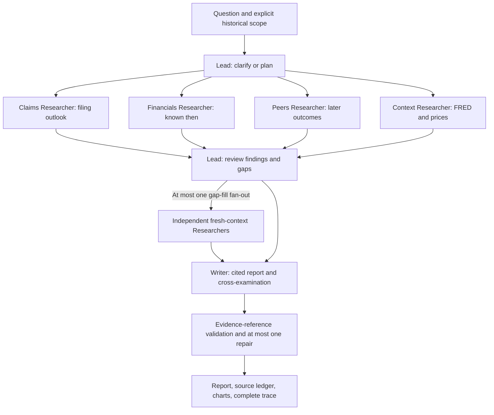

# The Receipts

**They said it. Did they deliver?** The Receipts helps investors and traders check public companies’ past management statements against later financial results and compare peers. It shows what was knowable at the time, what happened later, and which claims the available evidence can test.

**[Open the live application](https://the-receipts-7l4zrnepoq-ue.a.run.app/)** · Google sign-in is required for this deployment.

**Author:** Aditya Pendyala

## Use the application

1. Type a question naming the company and any peers, or select **Tesla**, **Coca-Cola**, or **Cloud giants** to fill in an example. Press **Enter** or click the submit arrow to start research.
2. Use **Research lens** to change the company, add up to two peers, or adjust the dates. **History begins** sets the start of the window; **Freeze the record** sets what was knowable then; **Reveal what followed** sets the cutoff for later results. Select **Browse the records** for a source preview without an AI report.
3. In the results, open **Check the management claims** to compare an outlook with its observed outcome. Under **Compare performance**, use **Show later results** to compare the historical view with what followed.
4. Open a numbered citation to inspect its source. **Sources** shows the evidence ledger, **Research log** shows the agents’ inputs and results, and **Download** exports the case as JSON.

## Example investigations and model-only comparisons

The featured cases use the default dates: **history starts January 1, 2020; information known by March 1, 2023; later results through March 1, 2025**. Use the same dates when entering the questions manually.

### 1. Tesla, GM, and Ford

> Did Tesla's growth expectations hold up after 2022? Cross-examine the evidence and compare annual revenue and profitability with GM and Ford.

**Expected answer:** Tesla revenue rose from $81.462B in 2022 to $97.690B in 2024. Annual revenue cannot test a vehicle-delivery target. GM’s 2024 total revenue was $187.442B ($171.606B covers contract revenue only); Ford reported $184.992B. Net income fell at Tesla and GM from 2023 to 2024 and rose at Ford. Separately, Tesla’s cash capital spending exceeded the original outlook ranges in 2023 and 2024.

**Sources:** [Tesla’s 2022 Form 10-K outlook](https://www.sec.gov/Archives/edgar/data/1318605/000095017023001409/tsla-20221231.htm) and SEC Company Facts for [Tesla](https://data.sec.gov/api/xbrl/companyfacts/CIK0001318605.json), [GM](https://data.sec.gov/api/xbrl/companyfacts/CIK0001467858.json), and [Ford](https://data.sec.gov/api/xbrl/companyfacts/CIK0000037996.json). [Recorded comparison](#automakers-same-model-comparison).

### 2. Coca-Cola and PepsiCo

> Did Coca-Cola deliver on its 2023 capital-spending outlook? Compare its stated expectation with actual capital spending, and compare 2023–2024 revenue and net income with PepsiCo.

**Expected answer:** Coca-Cola forecast approximately $1.9B of 2023 capital expenditures and reported $1.852B in cash purchases of property, plant, and equipment. Revenue rose at both companies in 2024: Coca-Cola from $45.754B to $47.061B and PepsiCo from $91.471B to $91.854B. Coca-Cola net income fell from $10.714B to $10.631B, while PepsiCo’s rose from $9.074B to $9.578B. Compare the companies by their respective fiscal years. PepsiCo capital spending was unavailable under the supported tags.

**Sources:** [Coca-Cola’s 2022 Form 10-K outlook](https://www.sec.gov/Archives/edgar/data/21344/000002134423000011/ko-20221231.htm) and SEC Company Facts for [Coca-Cola](https://data.sec.gov/api/xbrl/companyfacts/CIK0000021344.json) and [PepsiCo](https://data.sec.gov/api/xbrl/companyfacts/CIK0000077476.json). [Recorded comparison](#consumer-staples-same-model-comparison).

### 3. Microsoft, Amazon, and Alphabet

> Compare management growth and investment expectations with later annual revenue and capital expenditures for Microsoft, Amazon and Alphabet. Which claims can the data actually test?

**Expected answer:** Microsoft expected capital expenditures to rise to support cloud growth; company-wide cash purchases of property, plant, and equipment rose from $23.886B in FY2022 to $28.107B in FY2023 and $44.477B in FY2024. The company-wide figures support the direction of spending but do not isolate cloud investment. FY2024 revenue was $245.122B for Microsoft, $637.959B for Amazon, and $350.018B for Alphabet, with different fiscal year ends. Amazon capital spending was unavailable under the supported tags.

**Sources:** [Microsoft’s Form 10-Q for the quarter ended December 2022](https://www.sec.gov/Archives/edgar/data/789019/000156459023000733/msft-10q_20221231.htm) and SEC Company Facts for [Microsoft](https://data.sec.gov/api/xbrl/companyfacts/CIK0000789019.json), [Amazon](https://data.sec.gov/api/xbrl/companyfacts/CIK0001018724.json), and [Alphabet](https://data.sec.gov/api/xbrl/companyfacts/CIK0001652044.json). [Recorded comparison](#cloud-platforms-same-model-comparison).

### Recorded answers from the validation runs

These are actual Gemini runs, not illustrative transcripts. Each pair uses the same question, dates and model (`gemini-3.5-flash-lite`). Baselines have no tools or system prompt. Complete answers and agent/tool traces are retained in the linked JSON files.

| Case | Research status | Research latency | Trace |
|---|---|---:|---|
| Automakers | complete | 70.0 s | [Full trace and baseline](evaluations/automakers.json) |
| Consumer staples | complete | 17.95 s | [Full trace and baseline](evaluations/consumer-staples.json) |
| Cloud platforms | complete | 68.36 s | [Full trace and baseline](evaluations/cloud.json) |

#### Automakers: same-model comparison

<details>
<summary>No tools, no system prompt — complete recorded answer</summary>

To determine whether Tesla's growth expectations held up after 2022, we must cross-examine its operational metrics, financial trajectory, and market expectations against its legacy peers, General Motors (GM) and Ford Motor Company (F), covering the period from 2020 through the end of 2024.

---

### Part 1: Did Tesla's Growth Expectations Hold Up After 2022?

Prior to and through 2022, Tesla operated under the explicit long-term guidance of achieving a **50% compound annual growth rate (CAGR)** in vehicle deliveries over a multi-year horizon.

#### 1. The Delivery Growth Reality Check
* **Pre-2023 Execution:** Tesla largely delivered on its hyper-growth narrative. In 2021, deliveries grew by **87%** (to ~936k units), and in 2022, they grew by **40%** (to ~1.31 million units), coming close to the 50% target despite severe global supply chain disruptions and COVID-19 lockdowns in Shanghai.
* **Post-2022 Deceleration:** The 50% CAGR target broke down significantly after 2022:
  * **2023:** Tesla delivered ~1.81 million vehicles, representing a **38% YoY growth**—below the 50% target, achieved only through aggressive global price cuts that began in late 2022 and continued through 2023.
  * **2024:** Tesla delivered ~1.79 million vehicles (or roughly flat-to-modest growth depending on final reported classifications, representing a dramatic slowdown to **~1-2% YoY growth**).
* **The Verdict on Expectations:** **No, the structural hyper-growth expectations did not hold up.** Tesla transitioned from a high-growth startup phase into a cyclical, mass-market auto manufacturer constrained by aging vehicle architectures, rising global EV competition (particularly from Chinese rivals like BYD), and consumer fatigue with high interest rates. By 2024, management officially abandoned the 50% multi-year delivery growth guidance.

---

### Part 2: Financial Comparison (TSLA vs. GM vs. F)

To assess the financial health underpinning these growth expectations, we examine annual revenue and profitability (Net Income and Operating Margins) from 2020 through 2024.

#### A. Annual Revenue (in USD Billions)

| Company | 2020 | 2021 | 2022 | 2023 | 2024 |
| :--- | :--- | :--- | :--- | :--- | :--- |
| **Tesla (TSLA)** | $31.54B | $53.82B | $81.46B | $96.77B | **$97.69B** |
| **General Motors (GM)** | $122.48B | $127.00B | $156.74B | $171.84B | **$171.86B** |
| **Ford (F)** | $127.14B | $136.34B | $158.10B | $176.19B | **$179.76B** |

* **Revenue Analysis:**
  * **Tesla** experienced staggering top-line expansion between 2020 and 2022 (more than doubling revenue). However, post-2022, revenue growth hit a wall, rising by just ~18% in 2023 and flattening out near ~$97.7B in 2024 due to average selling price (ASP) declines driven by price cuts.
  * **GM and Ford** generate substantially more absolute revenue than Tesla (nearly double). Both legacy automakers saw steady post-pandemic revenue recovery through 2023, followed by top-line stabilization in 2024 as pricing power normalized across the industry.

#### B. Profitability: Net Income (in USD Billions)

| Company | 2020 | 2021 | 2022 | 2023 | 2024 |
| :--- | :--- | :--- | :--- | :--- | :--- |
| **Tesla (TSLA)** | $0.72B | $5.52B | $12.56B | $15.00B* | **$7.15B** |
| **General Motors (GM)** | $6.43B | $10.02B | $9.93B | $10.13B | **$3.60B** |
| **Ford (F)** | -$1.28B | $17.94B** | -1.98B | $4.35B | **$1.75B** |

*\*Note: Tesla's 2023 net income includes a massive one-time non-cash tax benefit of $5.9 billion. Without this, core operating earnings compressed severely.*
*\*\*Note: Ford’s 2021 net income was heavily skewed by its equity stake valuation in Rivian.*

* **Profitability Analysis:**
  * **Tesla's Margin Compression:** Post-2022, Tesla's profitability narrative deteriorated. Operating margins, which peaked near industry-leading levels of ~16-17% in 2022, dropped toward the high single digits by 2023–2024 as price cuts squeezed gross automotive margins (excluding regulatory credits). In 2024, net income was slashed by more than half compared to 2023 levels.
  * **Legacy Volatility:** GM and Ford maintained steady profitability through 2023 fueled by robust internal combustion engine (ICE) truck and SUV sales. However, both experienced margin hits in 2024 due to high warranty costs, labor contract wage increases (post-UAW strikes), and heavy operating losses in their dedicated EV divisions (Ford's *Model e* segment lost billions annually).

---

### Summary Conclusion

1. **Did Tesla's growth expectations hold up?** **No.** While Tesla remains the undisputed leader in Western EV adoption, the post-2022 era exposed the limits of its demand curve at previous price points. Delivery growth stalled significantly in 2023 and flatlined in 2024, forcing the company to pivot its narrative toward autonomous driving (FSD), AI, and robotics to justify its valuation.
2. **Financial Comparison:**
   * **Scale:** GM and Ford vastly outperform Tesla in total annual revenue, moving nearly double the volume of vehicles globally.
   * **Earnings Quality:** While Tesla historically enjoyed superior software-like operating margins, the post-2022 price wars compressed Tesla's profitability down closer to traditional automotive norms, while legacy automakers absorbed multi-billion-dollar losses attempting to scale their own EV portfolios.

</details>

<details>
<summary>The Receipts — complete evidence-based answer</summary>

# Tesla Growth Expectations and Peer Comparison Post-2022

**Mixed**

TSLA revenue for the fiscal period ended 2024-12-31 was $97.690 billion [E06fb99d6f5](https://www.sec.gov/Archives/edgar/data/1318605/000162828025003063/0001628280-25-003063-index.html), up from $96.773 billion for 2023-12-31 [E11b4f42020](https://www.sec.gov/Archives/edgar/data/1318605/000162828024002390/0001628280-24-002390-index.html). TSLA net income for the fiscal period ended 2024-12-31 was $7.091 billion [E882dff63b5](https://www.sec.gov/Archives/edgar/data/1318605/000162828025003063/0001628280-25-003063-index.html), down from $14.997 billion for 2023-12-31 [E67dab066ab](https://www.sec.gov/Archives/edgar/data/1318605/000162828024002390/0001628280-24-002390-index.html). TSLA cash PP&E purchases for the fiscal period ended 2024-12-31 was $11.339 billion [Efe9447dc7f](https://www.sec.gov/Archives/edgar/data/1318605/000162828025003063/0001628280-25-003063-index.html), up from $8.898 billion for 2023-12-31 [Ec516a365d5](https://www.sec.gov/Archives/edgar/data/1318605/000162828024002390/0001628280-24-002390-index.html). The retrieved outlook gave a capital-spending range of $6.000 billion to $8.000 billion for the year ending 2023-12-31 [E309c4ed784](https://www.sec.gov/Archives/edgar/data/1318605/000095017023001409/tsla-20221231.htm). Reported cash PP&E purchases were $8.898 billion, above quoted range [Ec516a365d5](https://www.sec.gov/Archives/edgar/data/1318605/000162828024002390/0001628280-24-002390-index.html). The retrieved outlook gave a capital-spending range of $7.000 billion to $9.000 billion for the year ending 2024-12-31 [E309c4ed784](https://www.sec.gov/Archives/edgar/data/1318605/000095017023001409/tsla-20221231.htm). Reported cash PP&E purchases were $11.339 billion, above quoted range [Efe9447dc7f](https://www.sec.gov/Archives/edgar/data/1318605/000162828025003063/0001628280-25-003063-index.html).

## What was knowable then

As of January 31, 2023, Tesla disclosed in its 2022 Form 10-K that it expected capital expenditures to range between $6.00 billion and $8.00 billion for fiscal year 2023, and between $7.00 billion and $9.00 billion for each of the subsequent two fiscal years [E309c4ed784](https://www.sec.gov/Archives/edgar/data/1318605/000095017023001409/tsla-20221231.htm) [E730dbabced](https://www.sec.gov/Archives/edgar/data/1318605/000095017023001409/tsla-20221231.htm). Management also noted that period-to-period financial results would fluctuate based on varying operating costs tied to product development and manufacturing capacity expansion [Ebd63825962](https://www.sec.gov/Archives/edgar/data/1318605/000095017023001409/tsla-20221231.htm).

## What happened later

In subsequent annual filings covering the post-2022 window, Tesla reported actual annual revenues of $96,773,000,000 in 2023 and $97,690,000,000 in 2024 [E11b4f42020](https://www.sec.gov/Archives/edgar/data/1318605/000162828024002390/0001628280-24-002390-index.html) [E06fb99d6f5](https://www.sec.gov/Archives/edgar/data/1318605/000162828025003063/0001628280-25-003063-index.html). Actual cash capital expenditures for property, plant, and equipment were $8,898,000,000 in 2023 and $11,339,000,000 in 2024, placing actual spending above the upper bounds of management's initial outlook ranges [Ec516a365d5](https://www.sec.gov/Archives/edgar/data/1318605/000162828024002390/0001628280-24-002390-index.html) [Efe9447dc7f](https://www.sec.gov/Archives/edgar/data/1318605/000162828025003063/0001628280-25-003063-index.html). Net income was reported at $14,997,000,000 for 2023 and $7,091,000,000 for 2024 [E67dab066ab](https://www.sec.gov/Archives/edgar/data/1318605/000162828024002390/0001628280-24-002390-index.html) [E882dff63b5](https://www.sec.gov/Archives/edgar/data/1318605/000162828025003063/0001628280-25-003063-index.html).

## The peer test

Comparing annual performance through 2024, General Motors generated annual revenues ranging from $122,485,000,000 in 2020 to $187,442,000,000 in 2024, alongside net income of $10,127,000,000 in 2023 and $6,008,000,000 in 2024 [E39346de73e](https://www.sec.gov/Archives/edgar/data/1467858/000146785821000037/0001467858-21-000037-index.html) [E16ec1705e6](https://www.sec.gov/Archives/edgar/data/1467858/000146785825000032/0001467858-25-000032-index.html) [Eb2e7c6d470](https://www.sec.gov/Archives/edgar/data/1467858/000146785824000031/0001467858-24-000031-index.html) [E1352fe29f3](https://www.sec.gov/Archives/edgar/data/1467858/000146785825000032/0001467858-25-000032-index.html). Ford generated annual revenues ranging from $127,144,000,000 in 2020 to $184,992,000,000 in 2024, with net income of $4,347,000,000 in 2023 and $5,879,000,000 in 2024 [E2259502fec](https://www.sec.gov/Archives/edgar/data/37996/000003799621000012/0000037996-21-000012-index.html) [E7a1d3a94d0](https://www.sec.gov/Archives/edgar/data/37996/000003799625000013/0000037996-25-000013-index.html) [E90b162746e](https://www.sec.gov/Archives/edgar/data/37996/000003799624000009/0000037996-24-000009-index.html) [Ebebae703eb](https://www.sec.gov/Archives/edgar/data/37996/000003799625000013/0000037996-25-000013-index.html). Over the same timeframe, Tesla's annual revenue grew from $31,536,000,000 in 2020 to $97,690,000,000 in 2024 [E968ca35acd](https://www.sec.gov/Archives/edgar/data/1318605/000156459021004599/0001564590-21-004599-index.html) [E06fb99d6f5](https://www.sec.gov/Archives/edgar/data/1318605/000162828025003063/0001628280-25-003063-index.html).

## Cross-examination

Management's qualitative statements regarding fluctuating operating costs and general investment intentions cannot be verified by revenue metrics [Ebd63825962](https://www.sec.gov/Archives/edgar/data/1318605/000095017023001409/tsla-20221231.htm). However, quantitative capital expenditure ranges can be tested directly against cash outflows for property, plant, and equipment [E309c4ed784](https://www.sec.gov/Archives/edgar/data/1318605/000095017023001409/tsla-20221231.htm) [Ec516a365d5](https://www.sec.gov/Archives/edgar/data/1318605/000162828024002390/0001628280-24-002390-index.html). The outcomes indicate that Tesla's actual capex exceeded the stated forecast bounds for both 2023 and 2024, demonstrating that spending acceleration outpaced initial estimates while top-line growth continued [E11b4f42020](https://www.sec.gov/Archives/edgar/data/1318605/000162828024002390/0001628280-24-002390-index.html) [E06fb99d6f5](https://www.sec.gov/Archives/edgar/data/1318605/000162828025003063/0001628280-25-003063-index.html) [Ec516a365d5](https://www.sec.gov/Archives/edgar/data/1318605/000162828024002390/0001628280-24-002390-index.html) [Efe9447dc7f](https://www.sec.gov/Archives/edgar/data/1318605/000162828025003063/0001628280-25-003063-index.html).

## Limits

- Ford annual capital expenditure metrics are missing from the primary XBRL dataset, precluding direct capex comparisons with GM and Tesla.

</details>


#### Consumer staples: same-model comparison

The fresh no-tools baseline reports 2023 Coca-Cola capital spending of $1.927B, 2024 revenue of $45.984B and 2024 net income of $9.985B. The retrieved SEC observations are $1.852B, $47.061B and $10.631B respectively. The agent also preserves PepsiCo’s fiscal dates and identifies the peer capital-spending coverage gap. This is one recorded comparison, not an estimate of general model accuracy.

<details>
<summary>No tools, no system prompt — complete recorded answer</summary>

### 1. Coca-Cola's 2023 Capital Spending: Stated Expectation vs. Actual

*   **Stated Expectation:** In its Q4 2022 earnings release and 2023 outlook (provided in early February 2023), The Coca-Cola Company anticipated capital expenditures (CapEx) for the full year 2023 to be approximately **$1.9 billion**.
*   **Actual Capital Spending:** According to Coca-Cola’s 2023 Form 10-K (Consolidated Statement of Cash Flows), actual cash paid for purchases of property, plant, and equipment (CapEx) in 2023 was **$1,927 million** (or approximately **$1.93 billion**).
*   **Conclusion:** Coca-Cola **delivered very closely** on its capital-spending outlook, coming in essentially right on target with its early-2023 guidance.

---

### 2. Financial Comparison: Coca-Cola vs. PepsiCo (2023–2024)

*Note: Coca-Cola operates primarily on a beverage-focused model, whereas PepsiCo operates a hybrid beverage and convenient foods (snacks/Frito-Lay) model, which inherently results in a significantly larger total revenue footprint for PepsiCo.*

#### **Revenue Comparison**
*   **The Coca-Cola Company (KO):**
    *   **2023 Net Operating Revenues:** $45,754 million (~$45.75 billion) — *up ~6% YoY from $43,004 million in 2022.*
    *   **2024 Net Operating Revenues:** $45,984 million (~$45.98 billion) — *up ~1% YoY.*
*   **PepsiCo, Inc. (PEP):**
    *   **2023 Net Revenue:** $91,471 million (~$91.47 billion) — *up ~9.5% YoY from $86,392 million in 2022.*
    *   **2024 Net Revenue:** $91,845 million (~$91.85 billion) — *up ~0.4% YoY.*

#### **Net Income Comparison**
*   **The Coca-Cola Company (KO):**
    *   **2023 Net Income (Attributable to Shareholders):** $10,714 million (~$10.71 billion) — *up ~12% YoY from $9,542 million in 2022.*
    *   **2024 Net Income (Attributable to Shareholders):** $9,985 million (~$9.99 billion) — *down ~7% YoY.*
*   **PepsiCo, Inc. (PEP):**
    *   **2023 Net Income (Attributable to Company):** $9,073 million (~$9.07 billion) — *up ~2% YoY from $8,910 million in 2022.*
    *   **2024 Net Income (Attributable to Company):** $9,332 million (~$9.33 billion) — *up ~3% YoY.*

---

### Summary Takeaways
1. **CapEx:** Coca-Cola successfully met its 2023 CapEx guidance of ~$1.9 billion by actually spending ~$1.93 billion.
2. **Scale:** PepsiCo generated roughly double the total revenue of Coca-Cola in both 2023 and 2024, driven by its massive snacks and food portfolio.
3. **Profitability:** Despite generating lower overall revenue, Coca-Cola consistently recorded higher absolute net income than PepsiCo across both 2023 and 2024 due to its higher net profit margins and asset-light bottling strategy (equity method investments).

</details>

<details>
<summary>The Receipts — complete evidence-based answer</summary>

# Coca-Cola 2023 Capital-Spending Outlook and Peer Comparison

**Supported**

Coca-Cola stated an expectation for 2023 capital expenditures of approximately $1.9 billion [E82c57991e1](https://www.sec.gov/Archives/edgar/data/21344/000002134423000011/ko-20221231.htm). Actual 2023 capital expenditures were reported as $1.852 billion [E647ed897d4](https://www.sec.gov/Archives/edgar/data/21344/000002134424000009/0000021344-24-000009-index.html), aligning with the approximate outlook. Across 2023 and 2024, Coca-Cola grew its annual revenues [Ee1bae635d7](https://www.sec.gov/Archives/edgar/data/21344/000002134424000009/0000021344-24-000009-index.html) [Ec41c902967](https://www.sec.gov/Archives/edgar/data/21344/000002134425000011/0000021344-25-000011-index.html) while net income rose in 2023 [E5035cbb36c](https://www.sec.gov/Archives/edgar/data/21344/000002134424000009/0000021344-24-000009-index.html) and decreased in 2024 [E123e0ecf48](https://www.sec.gov/Archives/edgar/data/21344/000002134425000011/0000021344-25-000011-index.html), and PepsiCo grew both its annual revenues and net incomes [Eb43b5f15bf](https://www.sec.gov/Archives/edgar/data/77476/000007747624000008/0000077476-24-000008-index.html) [Ebc8b9107fb](https://www.sec.gov/Archives/edgar/data/77476/000007747625000007/0000077476-25-000007-index.html) [E74678f2612](https://www.sec.gov/Archives/edgar/data/77476/000007747624000008/0000077476-24-000008-index.html) [Eb68ff6e569](https://www.sec.gov/Archives/edgar/data/77476/000007747625000007/0000077476-25-000007-index.html).

## Numbers on record

KO revenue for the fiscal period ended 2024-12-31 was $47.061 billion [Ec41c902967](https://www.sec.gov/Archives/edgar/data/21344/000002134425000011/0000021344-25-000011-index.html), up from $45.754 billion for 2023-12-31 [Ee1bae635d7](https://www.sec.gov/Archives/edgar/data/21344/000002134424000009/0000021344-24-000009-index.html). KO net income for the fiscal period ended 2024-12-31 was $10.631 billion [E123e0ecf48](https://www.sec.gov/Archives/edgar/data/21344/000002134425000011/0000021344-25-000011-index.html), down from $10.714 billion for 2023-12-31 [E5035cbb36c](https://www.sec.gov/Archives/edgar/data/21344/000002134424000009/0000021344-24-000009-index.html). KO cash PP&E purchases for the fiscal period ended 2024-12-31 was $2.064 billion [E799f9ee4c4](https://www.sec.gov/Archives/edgar/data/21344/000002134425000011/0000021344-25-000011-index.html), up from $1.852 billion for 2023-12-31 [E647ed897d4](https://www.sec.gov/Archives/edgar/data/21344/000002134424000009/0000021344-24-000009-index.html).

## What was knowable then

As of March 1, 2023, based on Coca-Cola's Form 10-K filed on February 21, 2023 for the period ending December 31, 2022, the company stated that it expected 2023 capital expenditures to be approximately $1.9 billion [E82c57991e1](https://www.sec.gov/Archives/edgar/data/21344/000002134423000011/ko-20221231.htm). Additionally, prior quarterly filings from 2022 showed consistent prior expectations for 2022 capital expenditures of approximately $1.5 billion [E786e4fa101](https://www.sec.gov/Archives/edgar/data/21344/000002134422000042/ko-20220930.htm) [E6993754f03](https://www.sec.gov/Archives/edgar/data/21344/000002134422000034/ko-20220701.htm). Historical financial results for both Coca-Cola and PepsiCo through year-end 2022 were accessible in their respective SEC filings [E4480890e69](https://www.sec.gov/Archives/edgar/data/21344/000002134423000011/0000021344-23-000011-index.html) [E14b6e0c8c0](https://www.sec.gov/Archives/edgar/data/77476/000007747623000007/0000077476-23-000007-index.html).

## What happened later

For the fiscal year ended December 31, 2023, Coca-Cola reported actual capital expenditures (payments to acquire property, plant and equipment) of $1,852,000,000 [E647ed897d4](https://www.sec.gov/Archives/edgar/data/21344/000002134424000009/0000021344-24-000009-index.html), which closely matched the approximately $1.9 billion expectation [E82c57991e1](https://www.sec.gov/Archives/edgar/data/21344/000002134423000011/ko-20221231.htm). In the subsequent fiscal year ended December 31, 2024, Coca-Cola's capital expenditures rose to $2,064,000,000 [E799f9ee4c4](https://www.sec.gov/Archives/edgar/data/21344/000002134425000011/0000021344-25-000011-index.html). Coca-Cola's revenue for fiscal 2023 was $45,754,000,000 with net income of $10,714,000,000, and for fiscal 2024 revenue was $47,061,000,000 with net income of $10,631,000,000 [Ee1bae635d7](https://www.sec.gov/Archives/edgar/data/21344/000002134424000009/0000021344-24-000009-index.html) [Ec41c902967](https://www.sec.gov/Archives/edgar/data/21344/000002134425000011/0000021344-25-000011-index.html) [E5035cbb36c](https://www.sec.gov/Archives/edgar/data/21344/000002134424000009/0000021344-24-000009-index.html) [E123e0ecf48](https://www.sec.gov/Archives/edgar/data/21344/000002134425000011/0000021344-25-000011-index.html).

## The peer test

PepsiCo reports on a fiscal calendar ending on the last Saturday of December, whereas Coca-Cola reports on a calendar year ending December 31. For fiscal year 2023 (period ending 2023-12-30), PepsiCo reported revenue of $91,471,000,000 and net income of $9,074,000,000 [Eb43b5f15bf](https://www.sec.gov/Archives/edgar/data/77476/000007747624000008/0000077476-24-000008-index.html) [E74678f2612](https://www.sec.gov/Archives/edgar/data/77476/000007747624000008/0000077476-24-000008-index.html). For fiscal year 2024 (period ending 2024-12-28), PepsiCo reported revenue of $91,854,000,000 and net income of $9,578,000,000 [Ebc8b9107fb](https://www.sec.gov/Archives/edgar/data/77476/000007747625000007/0000077476-25-000007-index.html) [Eb68ff6e569](https://www.sec.gov/Archives/edgar/data/77476/000007747625000007/0000077476-25-000007-index.html). PepsiCo annual capital expenditures under supported XBRL tags are missing in the provided dataset [E5b96e2debc]. Both companies demonstrated growing revenues across 2023 and 2024 [Eb43b5f15bf](https://www.sec.gov/Archives/edgar/data/77476/000007747624000008/0000077476-24-000008-index.html) [Ebc8b9107fb](https://www.sec.gov/Archives/edgar/data/77476/000007747625000007/0000077476-25-000007-index.html) [Ee1bae635d7](https://www.sec.gov/Archives/edgar/data/21344/000002134424000009/0000021344-24-000009-index.html) [Ec41c902967](https://www.sec.gov/Archives/edgar/data/21344/000002134425000011/0000021344-25-000011-index.html), while net income trajectories diverged in 2024 as PepsiCo's net income increased [Eb68ff6e569](https://www.sec.gov/Archives/edgar/data/77476/000007747625000007/0000077476-25-000007-index.html) and Coca-Cola's net income decreased [E123e0ecf48](https://www.sec.gov/Archives/edgar/data/21344/000002134425000011/0000021344-25-000011-index.html).

## Cross-examination

Management's statement regarding 2023 capital expenditures was phrased as an approximation ("approximately $1.9 billion") rather than a strict numeric guarantee [E82c57991e1](https://www.sec.gov/Archives/edgar/data/21344/000002134423000011/ko-20221231.htm). The actual reported figure of $1.852 billion falls inside a reasonable margin around this estimate [E647ed897d4](https://www.sec.gov/Archives/edgar/data/21344/000002134424000009/0000021344-24-000009-index.html). Investors must distinguish between directional commentary on cost pressures—such as expected impacts on gross margins or foreign currency fluctuations—and verifiable quantitative spending outcomes [Ea83c42e034](https://www.sec.gov/Archives/edgar/data/21344/000002134423000011/ko-20221231.htm) [Ee3824abbb6](https://www.sec.gov/Archives/edgar/data/21344/000002134422000042/ko-20220930.htm). Revenue growth provides no direct verification of spending targets.

## Limits

- PepsiCo annual capital expenditures (capex) data is absent under supported XBRL tags in the available dataset [E5b96e2debc], preventing a direct capex peer comparison. Specific funding sources and segment-level breakdowns for Coca-Cola's capital expenditures remain unverified by entity-wide cash totals.

</details>


#### Cloud platforms: same-model comparison

<details>
<summary>No tools, no system prompt — complete recorded answer</summary>

### Executive Summary: What the Data Can Actually Test

Comparing management guidance, forward-looking investment expectations, and subsequent actual financial performance for **Microsoft (MSFT)**, **Amazon (AMZN)**, and **Alphabet (GOOGL)** from 2020 through early 2025 reveals distinct patterns in how these tech giants communicate strategic shifts.

However, before diving into the data, we must rigorously define **what historical financial data can and cannot test**.

#### 1. What the Data CAN Test:
*   **Directional Accuracy of CapEx Cycles:** Whether management’s qualitative or quantitative signals regarding upcoming infrastructure acceleration (e.g., cloud expansion, AI data centers) successfully foreshadowed actual spikes in capital expenditures 12 to 24 months later.
*   **Revenue Growth Realism:** Whether consensus-driven or management-implied growth targets aligned with realized top-line deceleration or re-acceleration, particularly through the post-pandemic normalization (2022–2023) and the subsequent Generative AI boom (2023–2024).
*   **Capital Intensity Trends:** Changes in the efficiency of capital deployment—measured by incremental revenue generated per dollar of CapEx—as these firms transitioned from enterprise cloud growth to heavy AI infrastructure spending.

#### 2. What the Data CANNOT Test:
*   **Exact Guidance Verification for All Three:** None of these companies provide systematic, long-term quantitative multi-year revenue or CapEx guidance. Unlike industrial or retail firms, mega-cap tech management teams typically avoid explicit annual revenue targets, relying instead on quarterly margin commentary, cloud growth rate ranges (in constant currency), and vague CapEx directional phrases (e.g., *"CapEx will increase sequentially to support AI demand"*). Therefore, we cannot test specific numerical management "promises" against outcomes; rather, we test **strategic intent vs. capital allocation execution**.
*   **Attribution of ROI on AI CapEx:** While we can observe multi-billion-dollar surges in CapEx (particularly starting in FY2023/FY2024), financial statements do not isolate returns on Generative AI infrastructure from traditional cloud (Azure, AWS, GCP) or search infrastructure. Thus, claims about the immediate profitability or financial success of specific strategic pivots cannot be definitively isolated in standard GAAP reporting.

---

### Company-by-Company Analysis (2020 – 2025)

---

### 1. Microsoft (MSFT)
*   **Strategic Narrative:** Transitioned from steady enterprise cloud (Azure) growth during the pandemic to an aggressive, industry-leading pivot into Generative AI via partnerships (OpenAI) and proprietary silicon/infrastructure in 2023–2024.

#### Quantitative Overview (FY-aligned where applicable)
*   *Note: Microsoft’s fiscal year ends June 30.*
*   **FY 2020:** Revenue: ~$143B | CapEx: ~$15.4B
*   **FY 2022:** Revenue: ~$198B | CapEx: ~$23.9B
*   **FY 2024:** Revenue: ~$245B | CapEx: ~$55.7B (Driven heavily by AI data center buildouts)
*   **H1 FY2025 (Dec 31, 2024):** CapEx continued to scale aggressively, crossing annualized runs above $70B+.

#### Testing Management Expectations vs. Reality
1.  **Claim:** *Management successfully signaled the massive infrastructure ramp-up well before CapEx spiked.*
    *   **Test Result:** **Confirmed.** Throughout FY2023 earnings calls, Microsoft executives explicitly warned that cloud optimization cycles were maturing, but simultaneously emphasized that AI demand was outstripping capacity.
    *   **The Data:** CapEx jumped from $23.9B in FY22 to $31.9B in FY23, and then skyrocketed by over 74% to $55.7B in FY24. Management's qualitative signals correctly predicted the inflection point, though the *magnitude* of the CapEx acceleration caught many market analysts off guard.
2.  **Claim:** *Heavy infrastructure investments successfully protected or accelerated top-line growth.*
    *   **Test Result:** **Mixed / Partially Testable.** Revenue growth slowed from double digits during the pandemic peak to ~7% in FY23 (Constant Currency), but re-accelerated to ~16% in FY24 as Azure incorporated AI workloads (Azure growth rates explicitly separated AI contributions, showing 6–8 points of growth coming from AI by mid-2024). Thus, the capital outlays correlated directly with stabilizing and re-accelerating cloud growth.

---

### 2. Amazon (AMZN)
*   **Strategic Narrative:** Overshot physical and logistics capacity during the 2020–2021 e-commerce boom, leading to severe over-investment, followed by a dramatic contraction in CapEx in 2022, and a subsequent re-acceleration in 2023–2024 driven by AWS modernization and AI infrastructure.

#### Quantitative Overview
*   **FY 2020:** Revenue: ~$386B | CapEx (Property & Equipment): ~$40.0B
*   **FY 2021:** Revenue: ~$470B | CapEx: ~$61.1B (Peak pandemic fulfillment buildout)
*   **FY 2023:** Revenue: ~$574B | CapEx: ~$52.7B (Post-rationalization, shifting back toward tech/AI)
*   **FY 2024 (Ended Dec 31, 2024):** CapEx surged past $75B+ as AWS doubled down on custom chips (Trainium/Inferentia) and data centers.

#### Testing Management Expectations vs. Reality
1.  **Claim:** *Management’s realization of over-capacity in 2022 led to a disciplined pullback in capital allocation.*
    *   **Test Result:** **Confirmed.** In early 2022, Andy Jassy and Brian Olsavsky openly admitted they had doubled their fulfillment network size too quickly.
    *   **The Data:** CapEx growth flattened and actually dropped absolute dollars in 2022 ($59.0B down from $61.1B in '21) while revenue growth decelerated sharply to ~9% in 2022. Management successfully diagnosed the over-capacity issue and slowed logistics deployment.
2.  **Claim:** *Subsequent management guidance regarding "AI as the next leg of growth" justified a return to aggressive CapEx spending in 2023–2024.*
    *   **Test Result:** **Confirmed by Data, Unprovable on Exact ROI.** Amazon re-accelerated CapEx significantly through 2024 to support AWS customer demand for generative AI. While AWS revenue growth recovered from its early 2023 lows (dipping below 15% to returning to ~19% by late 2024), separating traditional cloud migration revenue from net-new AI revenue remains impossible using standard public filings.

---

### 3. Alphabet (GOOGL)
*   **Strategic Narrative:** Benefited from an advertising boom in 2021, faced an ad-spend recession in 2022, and restructured its cost base while aggressively pivoting its entire product stack (Search, GCP, Workspace) to Generative AI (Gemini) through 2023–2025.

#### Quantitative Overview
*   **FY 2020:** Revenue: ~$182B | CapEx: ~$22.4B
*   **FY 2022:** Revenue: ~$282B | CapEx: ~$31.5B
*   **FY 2024:** Revenue: ~$307B+ | CapEx: Scaled rapidly toward $50B+ annualized run rates by late 2024/early 2025 for servers and data centers.

#### Testing Management Expectations vs. Reality
1.  **Claim:** *Management's 2023 "shared AI focus" and cost-discipline mandates successfully protected operating margins despite surging infrastructure costs.*
    *   **Test Result:** **Confirmed.** In early 2023, CEO Sundar Pichai and CFO Ruth Porat emphasized "durably re-engineering our cost base."
    *   **The Data:** Alphabet slowed headcount growth and optimized office space, which, combined with stabilizing advertising revenues, caused operating margins to *expand* from ~26% in 2022 to nearly 30% by late 2024, even as technical infrastructure CapEx accelerated. Management successfully walked the tightrope of funding heavy AI investments while cutting non-core operational fat.
2.  **Claim:** *Cloud (GCP) growth rates would validate management's investment in enterprise AI services.*
    *   **Test Result:** **Confirmed.** GCP transitioned from a low-margin challenger to a high-growth profit driver, with growth rates consistently outpacing or matching market expectations through 2023–2024, explicitly driven by AI infrastructure adoption by enterprise clients.

---

### Comparative Synthesis: CapEx Intensity (2020–2024)

| Metric / Trend | Microsoft (MSFT) | Amazon (AMZN) | Alphabet (GOOGL) |
| :--- | :--- | :--- | :--- |
| **Primary CapEx Driver (2020-22)** | Azure Cloud & Global Regions | Logistics, Fulfillment, & AWS | Data Centers & GCP Expansion |
| **Primary CapEx Driver (2023-25)** | Generative AI / OpenAI partnership | Logistics correction $\rightarrow$ AWS AI chips & Data Centers | Gemini Infrastructure & Cloud AI |
| **CapEx-to-Revenue Trend** | Significant upward shift (from ~10% to ~20%+) | U-shaped curve (Peak 2021, dip 2022, steep rise 23-24) | Upward shift, though buffered by high-margin ad revenue |
| **Management Signal Reliability** | **High:** Early and transparent warnings of AI capacity constraints. | **High:** Candid admissions of over-capacity followed by swift pivots. | **Moderate-High:** Emphasized cost discipline while stealthily ramping tech infrastructure. |

### Conclusion

The data confirms that for Microsoft, Amazon, and Alphabet, **management commentary regarding structural shifts (such as the 2023 AI pivot) served as highly reliable leading indicators for massive capital expenditure surges 12–18 months later.**

However, because these firms do not provide long-term quantitative revenue guidance, and because GAAP financial statements lump AI infrastructure investments together with legacy cloud and search maintenance, **investors cannot use public financial data to test the precise return on investment (ROI) of the multi-billion-dollar AI buildout.** We can only observe that top-line growth stabilized or re-accelerated as these capital investments hit the balance sheet, proving strategic execution, but leaving exact asset-level profitability unquantifiable.

</details>

<details>
<summary>The Receipts — complete evidence-based answer</summary>

# Comparison of Big Tech Management Expectations and Subsequent Financial Outcomes

**Mixed**

MSFT revenue for the fiscal period ended 2024-06-30 was $245.122 billion [Eed004d4da4](https://www.sec.gov/Archives/edgar/data/789019/000095017024087843/0000950170-24-087843-index.html), up from $211.915 billion for 2023-06-30 [E108c50cdc8](https://www.sec.gov/Archives/edgar/data/789019/000095017023035122/0000950170-23-035122-index.html). MSFT net income for the fiscal period ended 2024-06-30 was $88.136 billion [E8d5731e201](https://www.sec.gov/Archives/edgar/data/789019/000095017024087843/0000950170-24-087843-index.html), up from $72.361 billion for 2023-06-30 [E5b14d92531](https://www.sec.gov/Archives/edgar/data/789019/000095017023035122/0000950170-23-035122-index.html). MSFT cash PP&E purchases for the fiscal period ended 2024-06-30 was $44.477 billion [Ec239d250c2](https://www.sec.gov/Archives/edgar/data/789019/000095017024087843/0000950170-24-087843-index.html), up from $28.107 billion for 2023-06-30 [Ed8f17dfdba](https://www.sec.gov/Archives/edgar/data/789019/000095017023035122/0000950170-23-035122-index.html).

## What was knowable then

As of early 2023, Microsoft and Alphabet filings contained qualitative statements regarding anticipated increases in capital expenditures to support cloud growth [Ef9ff8dea97](https://www.sec.gov/Archives/edgar/data/789019/000156459023000733/msft-10q_20221231.htm) [Ea150dd06a5](https://www.sec.gov/Archives/edgar/data/789019/000156459022035087/msft-10q_20220930.htm) and potential moderation in revenue growth rates [Ec7992a4f1c](https://www.sec.gov/Archives/edgar/data/1652044/000165204423000016/goog-20221231.htm) [E78c4390f98](https://www.sec.gov/Archives/edgar/data/1652044/000165204423000016/goog-20221231.htm). Amazon similarly reported expectations for continued investments in technology infrastructure over time [E9174b902ca](https://www.sec.gov/Archives/edgar/data/1018724/000101872423000004/amzn-20221231.htm) [Ed8b9b6b5af](https://www.sec.gov/Archives/edgar/data/1018724/000101872422000023/amzn-20220930.htm). However, detailed multi-year numeric expenditure targets were absent from these disclosures [Ea150dd06a5](https://www.sec.gov/Archives/edgar/data/789019/000156459022035087/msft-10q_20220930.htm) [E9174b902ca](https://www.sec.gov/Archives/edgar/data/1018724/000101872423000004/amzn-20221231.htm). Additionally, Amazon's specific capital expenditure XBRL tags were not available in the reported financial dataset [E784b2e78a0].

## What happened later

Subsequent annual financial results confirmed that Microsoft's capital expenditures increased from $23,886,000,000 for the fiscal year ended June 30, 2022, to $28,107,000,000 for fiscal 2023 and further to $44,477,000,000 for fiscal 2024 [E32b89b1cd9](https://www.sec.gov/Archives/edgar/data/789019/000156459022026876/0001564590-22-026876-index.html) [Ed8f17dfdba](https://www.sec.gov/Archives/edgar/data/789019/000095017023035122/0000950170-23-035122-index.html) [Ec239d250c2](https://www.sec.gov/Archives/edgar/data/789019/000095017024087843/0000950170-24-087843-index.html). Alphabet reported annual capital expenditures rising from $31,485,000,000 for 2022 to $32,251,000,000 for 2023 and $52,535,000,000 for 2024, alongside entity-wide revenue expansion [E478bf93c31](https://www.sec.gov/Archives/edgar/data/1652044/000165204423000016/0001652044-23-000016-index.html) [E07c617d17a](https://www.sec.gov/Archives/edgar/data/1652044/000165204424000022/0001652044-24-000022-index.html) [E4ed40591c0](https://www.sec.gov/Archives/edgar/data/1652044/000165204425000014/0001652044-25-000014-index.html) [E4b55211566](https://www.sec.gov/Archives/edgar/data/1652044/000165204424000022/0001652044-24-000022-index.html). Microsoft's annual revenue grew to $211,915,000,000 in fiscal 2023 and $245,122,000,000 in fiscal 2024 [E108c50cdc8](https://www.sec.gov/Archives/edgar/data/789019/000095017023035122/0000950170-23-035122-index.html) [Eed004d4da4](https://www.sec.gov/Archives/edgar/data/789019/000095017024087843/0000950170-24-087843-index.html).

## The peer test

Comparing annual metrics across the peer group through fiscal 2024 shows divergent operational scales and reporting cycles. Microsoft (reporting on a June fiscal year) expanded annual revenue from $198,270,000,000 in 2022 to $245,122,000,000 in 2024 [Ee22df39a5d](https://www.sec.gov/Archives/edgar/data/789019/000156459022026876/0001564590-22-026876-index.html) [Eed004d4da4](https://www.sec.gov/Archives/edgar/data/789019/000095017024087843/0000950170-24-087843-index.html). Alphabet (reporting on a calendar year) grew annual revenue from $282,836,000,000 in 2022 to $350,018,000,000 in 2024 [E4ab3613f1b](https://www.sec.gov/Archives/edgar/data/1652044/000165204423000016/0001652044-23-000016-index.html) [E01621ef444](https://www.sec.gov/Archives/edgar/data/1652044/000165204425000014/0001652044-25-000014-index.html). Amazon (also on a calendar year) grew revenue from $513,983,000,000 in 2022 to $637,959,000,000 in 2024 [E3c48e69f0a](https://www.sec.gov/Archives/edgar/data/1018724/000101872423000004/0001018724-23-000004-index.html) [E44a6ba79a4](https://www.sec.gov/Archives/edgar/data/1018724/000101872425000004/0001018724-25-000004-index.html). Direct peer comparison of capital expenditures is limited by missing annual capex tags for Amazon [E784b2e78a0].

## Cross-examination

Management disclosures often blend qualitative directional commentary with unobservable funding sources, which prevents treating general outlook statements as verifiable mathematical promises [Ef9ff8dea97](https://www.sec.gov/Archives/edgar/data/789019/000156459023000733/msft-10q_20221231.htm) [E9174b902ca](https://www.sec.gov/Archives/edgar/data/1018724/000101872423000004/amzn-20221231.htm). While observed capital expenditures at Microsoft and Alphabet trended upward in subsequent periods, matching these outcomes does not retroactively verify management intent or prove causation from past qualitative guidance [E32b89b1cd9](https://www.sec.gov/Archives/edgar/data/789019/000156459022026876/0001564590-22-026876-index.html) [Ed8f17dfdba](https://www.sec.gov/Archives/edgar/data/789019/000095017023035122/0000950170-23-035122-index.html) [E478bf93c31](https://www.sec.gov/Archives/edgar/data/1652044/000165204423000016/0001652044-23-000016-index.html) [E07c617d17a](https://www.sec.gov/Archives/edgar/data/1652044/000165204424000022/0001652044-24-000022-index.html). Statements regarding expected growth are broad qualitative assessments rather than precise quantitative targets [Ea150dd06a5](https://www.sec.gov/Archives/edgar/data/789019/000156459022035087/msft-10q_20220930.htm) [Ed8b9b6b5af](https://www.sec.gov/Archives/edgar/data/1018724/000101872422000023/amzn-20220930.htm).

## Limits

- Amazon capital expenditure figures are absent due to missing XBRL tags in the retrieved dataset.
- Management statements lack explicit quantitative horizons or multi-year figures, restricting analysis to directional comparisons.

</details>


To reproduce all three real model/tool runs and baselines (billable only to the configured GCP project):

```bash
uv run python -m scripts.smoke_research
```

The script records latency, model name, answers, citations, evidence and full traces. These are recorded comparisons, not estimates of general model accuracy.

## Research architecture



There are three distinct agent shapes: Lead, Researcher and Writer. Four specialized Researchers fan out concurrently in a `ThreadPoolExecutor` from one Lead planning turn. Each receives only its task, scoped tool menu and its own tool results. A Researcher never receives another Researcher's conversation. A gap-fill Researcher also starts with a fresh context.

Researchers choose structured tool requests; the server validates the tool name and scoped ticker, supplies the date boundaries, executes the public-data adapter, and returns evidence to that Researcher's next model turn. No agent can fetch arbitrary URLs or widen the server's historical scope. The Lead reviews findings, recorded source calls and failures, then can dispatch up to two missing-source tasks in one additional parallel round. Finally, the Writer receives the assembled ledger and arithmetic changes/range checks. A fresh Writer editing pass checks factual consistency before reference validation. The opening summary is assembled deterministically from reported annual observations and explicit quoted-range calculations; free-form interpretation remains in the cited sections.

Bounds: **2 research rounds**, **3 decision turns per Researcher**, **22 distinct source tool calls**, one Writer factual-editing pass and one citation-repair attempt, and a **240-second model/research budget**. Individual source HTTP requests time out at 18 seconds; model requests at 38 seconds or the remaining budget. A slow in-flight source request may run past the soft research budget; Cloud Run has a 300-second request timeout. At most two user investigations run simultaneously in one instance. These are application controls, not distributed rate limits or a hard billing cap.

When required company/date information is absent, the Lead asks for clarification before calling any source tool. Explicit frontend scope overrides model-inferred scope. Source failures are recorded as gaps. The Writer must acknowledge missing evidence; a failed model request or citation gate returns an explicit unavailable result with collected evidence, never a fabricated report.

Citation validation checks evidence existence, rejects unknown references and generated URLs; a gap reference can support only an explicit statement about missing evidence, normalizes grouped references, and requires actual management passages for claim receipts. It also requires same-company outcomes for testable receipts, a compatible financial metric, and a financial period ending after the management statement. The historical-knowledge section cannot cite later filings or revised market/macro context. A claim card without outcomes is conservatively marked not testable; an overall claim verdict without any testable receipts becomes insufficient evidence. It does **not** prove semantic entailment of every sentence or automatically guarantee that two accounting definitions match. Inspect the primary sources. Qualitative, segment-specific, operational or undated promises may remain **not testable** with entity-wide annual financial data.

### Chat API

`POST /chat` still accepts `message` and optional `session_id`, and returns the original fields:

```json
{
  "response": "A cited Markdown investigation or a clarification",
  "session_id": "a UUID",
  "tool_calls": [
    {"agent": "Claims", "name": "claims", "args": {}, "result": "JSON string", "elapsed_ms": 123}
  ],
  "investigation": {"status": "complete", "scope": {}, "report": {}, "evidence": [], "limits": [], "rounds": 1}
}
```

`scope` is an optional request extension: `{"tickers":["TSLA","GM","F"],"start":"2020-01-01","as_of":"2023-03-01","through":"2025-03-01"}`. The extra `investigation` response field powers the interface; the original `response`, `session_id`, `tool_calls`, and string-valued `result` contract remains intact. **Every model stage and every sub-agent source call includes `agent`.** `POST /evidence` returns the same shape with `status=preview` and no model verdict. `POST /clear` accepts `session_id`. `GET /health` is service liveness, not a claim that model credentials work. `GET /catalog` lists starter industries and bounds.

Sessions retain only the previous scope and question, not entire prior reports. An unscoped follow-up may reuse that scope; answers are researched afresh. Sessions are isolated by random UUID, expire after 30 minutes idle, are capped at 100, and disappear on restart. The browser stores the session ID in tab-scoped `sessionStorage`.

## Data sources and reproducibility

This solo project uses **three source families**. There are no paid financial-data services or third-party paid model APIs. Gemini requests use the named GCP project and its existing Vertex AI access.

| Source | Data and access | Interpretation |
|---|---|---|
| [SEC EDGAR](https://www.sec.gov/search-filings/edgar-application-programming-interfaces) | Keyless submissions JSON, archived annual/quarterly filing HTML and Company Facts XBRL | Management excerpts and annual entity financials; exact filing/accession and XBRL tag retained |
| [FRED](https://fred.stlouisfed.org/) | Keyless graph CSV for `FEDFUNDS` and `CPIAUCSL` | Macro context. Current revised history; **not** an ALFRED real-time vintage |
| [Yahoo Finance historical prices](https://finance.yahoo.com/quote/TSLA/history/) | Keyless, unofficial chart endpoint, `indicators.adjclose` | Best-effort vendor-adjusted daily closing history. No live quote, execution price or causal inference |

The runtime source-text cache is capped at 64 million characters and 160 URLs. The source loader archives original UTF-8 source bodies with retrieval time, original URL and SHA-256. About 13 MB of gzip archives in `data/snapshots/` ship with the deployment; [The data manifest](data/manifest.json) records coverage. A snapshot is fetched **at archive time**, not at the historical cutoff. The app separately filters SEC records by actual filing date. Source hashes are checked before archives are used. No credentials are stored with the data.

Bundled peer groups:

- Automakers: Tesla (`TSLA`), General Motors (`GM`), Ford (`F`).
- Consumer staples: Coca-Cola (`KO`), PepsiCo (`PEP`).
- Archived semiconductor comparisons: NVIDIA (`NVDA`), AMD (`AMD`), Intel (`INTC`).
- Cloud platforms: Microsoft (`MSFT`), Amazon (`AMZN`), Alphabet (`GOOGL`).

These are curated peer groups, not exhaustive industry universes, and membership is contemporary. They are subject to survivorship and selection bias. Other tickers resolve through the SEC's current ticker directory. Foreign/private companies, delisted-company discovery and complete historical industry membership are outside this version.

### Load the data

```bash
uv sync --locked
uv run python -m scripts.load_data
```

The loader gets the starter companies’ and Coca-Cola/PepsiCo’s Company Facts and price history, filing submissions and up to three recent filings for each demo company, plus the two macro series. It preserves existing matching archives. To refresh a specific source, remove its archive from `data/snapshots/` and rerun the loader; keep the prior archive elsewhere if reproducibility matters. Each filename is the SHA-256 of the source URL. Live fetches use an in-process cache, while the loader explicitly persists archives. Set `OFFLINE_DATA=1` to require bundled data and return explicit gaps elsewhere.

Endpoint patterns:

```text
https://data.sec.gov/submissions/CIK##########.json
https://data.sec.gov/submissions/CIK##########-submissions-NNN.json
https://data.sec.gov/api/xbrl/companyfacts/CIK##########.json
https://www.sec.gov/Archives/edgar/data/{cik}/{accession_without_dashes}/{primaryDocument}
https://fred.stlouisfed.org/graph/fredgraph.csv?id={series}&cosd={start}&coed={end}
https://query1.finance.yahoo.com/v8/finance/chart/{ticker}?period1={unix_start}&period2={exclusive_unix_end}&interval=1d
```

The SEC User-Agent identifies your application and its contact email. A shared process adapter paces SEC request starts at less than five per second; one Cloud Run instance is configured. A block, invalid response, missing adjusted close or missing series becomes an explicit evidence gap. No raw-close or invented financial fallback is substituted.

### Scope and limitations

Financial facts must be USD, from annual 10-K/10-K/A filings, with duration **330–380 days**. YTD, quarterly and instant values are excluded. Only facts filed on or before the requested availability date are eligible. For each period the adapter takes the earliest filed observation, breaking ties using a documented tag preference. This preserves original-reported observations instead of silently replacing them with later restatements. Historical SEC facts cannot enter the known-then room merely because their fiscal period ended before the cutoff.

Total `Revenues` takes precedence over contract revenue where both are reported, particularly for automakers with financing businesses. Revenue fallback concepts and capex definitions can still differ; the exact tag is exposed in the ledger. Cash capex uses `PaymentsToAcquirePropertyPlantAndEquipment`. No segment aggregation, quarter derivation, inflation adjustment, GAAP reconciliation or currency conversion is inferred. NVIDIA and Microsoft fiscal-year ends differ from calendar-year peers. Future filings, later restatements, revised FRED series and retrospectively adjusted stock prices cannot support a statement about what investors knew at the cutoff.

Management passages are a ranked, bounded retrieval from at most three latest 10-K/10-Q filings in the selected range. It is a sentence-level normalized excerpt search for forward-looking language, not an exhaustive earnings-call archive, semantic search across all exhibits or proof that no other guidance existed. The UI exposes the exact excerpt and a find-in-filing locator. Only explicitly retrieved passages can become claim receipts.

The app compares company-wide annual results. It does not reconstruct earnings calls, infer operating targets from financial results, reconstruct historical macroeconomic vintages, or test causation.

## Run locally

Requires Python 3.12+ and [uv](https://docs.astral.sh/uv/). No secret API key is needed.

```bash
uv sync --locked
gcloud auth application-default login
export GOOGLE_CLOUD_PROJECT=your-google-cloud-project-id
export SEC_USER_AGENT="TheReceipts your-contact-email@example.com"
uv run python app.py
```

Open `http://localhost:8000`. When ADC is absent locally, the model adapter can reuse the configured `gcloud` sign-in, keeping the token in memory. Cloud Run uses its service account and never invokes `gcloud`. Model failures expose a useful error, not credential contents. The configurable model is `GEMINI_MODEL`, defaulting to `gemini-3.5-flash-lite`; `SEC_USER_AGENT` can set another valid project contact.

## Verification

The regression suite has 86 Python tests and 8 JavaScript tests. It covers historical filing cutoffs, financial definitions, source integrity, citation and claim checks, sessions, the chat API contract, and parallel research with bounded follow-ups.

```bash
uv run pytest -q
node --test tests/company-directory.test.cjs
```

The [functional audit](evaluations/ai-audit-2026-11-07/README.md) records real research prompts and edge cases, including unavailable data and rate limits. The [Coca-Cola example record](evaluations/coca-cola-example-2026-11-07/README.md) documents the featured case. To run the live research suite against a locally running app with Vertex AI credentials, use `uv run python -m scripts.test_live --base-url http://localhost:8000`. For the deployed app, use an account with access.

## Deployment

[Cloud Build](cloudbuild.yaml) runs the tests, builds the image, and deploys to Cloud Run on pushes to `main`. The deployed image ships with the source archives in `data/snapshots/`. The Cloud Run request timeout is 300 seconds; the agent has its own 240-second research budget and turn limits.

The service uses Google Cloud Identity-Aware Proxy (IAP). Unauthenticated requests go to sign-in. A manual deployment fallback is available in [scripts/deploy.sh](scripts/deploy.sh).

The interface’s design references, accessibility controls, and implementation notes are in [DESIGN.md](DESIGN.md).
