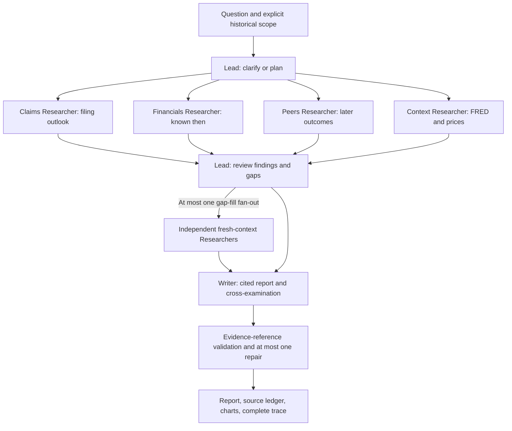

# The Receipts

**They said it. Did they deliver?** The Receipts is a historical financial investigation desk for investors and traders. It compares management outlook passages with subsequent reported financial results and puts the company beside its industry peers. Every investigation exposes the evidence and the agent/tool trace.

**Author:** Aditya Pendyala, ap4839@columbia.edu · **IEOR 4570 Project 2:** `research` (Deep Research).

## Use the application

1. Enter one to three U.S. public-company tickers. The first is the company under investigation; the others are comparison peers.
2. Choose a history start, a historical knowledge cutoff, and an outcome horizon. For the bundled cases use **2020-01-01 / 2023-03-01 / 2025-03-01**.
3. Ask a specific question about historical expectations and later results.
4. Choose **Open evidence** for a model-free source preview or **Investigate** for the multi-agent report.
5. Use the chart's metric selector, peer visibility controls, knowledge-date replay slider and hindsight toggle. Open the evidence ledger, follow primary-source links, inspect the research trace, or export the entire case as JSON.

The interface explains the audience, workflow, data boundaries and difference between evidence preview and AI investigation. It renders model text as text nodes, with server-validated evidence references linked to the ledger. Model-generated HTML is never injected.

## Research architecture



There are three distinct agent shapes: Lead, Researcher and Writer. Four specialized Researchers fan out concurrently in a `ThreadPoolExecutor` from one Lead planning turn. Each receives only its task, scoped tool menu and its own tool results. A Researcher never receives another Researcher's conversation. A gap-fill Researcher also starts with a fresh context.

Researchers choose structured tool requests; the server validates the tool name and scoped ticker, supplies the date boundaries, executes the public-data adapter, and returns evidence to that Researcher's next model turn. No agent can fetch arbitrary URLs or widen the server's historical scope. The Lead reviews findings, recorded source calls and failures, then can dispatch up to two missing-source tasks in one additional parallel round. Finally, the Writer receives the assembled ledger.

Bounds: **2 research rounds**, **3 decision turns per Researcher**, **22 distinct source tool calls**, one Writer citation-repair attempt, and a **240-second model/research budget**. Individual source HTTP requests time out at 18 seconds; model requests at 38 seconds or the remaining budget. A slow in-flight source request may run past the soft research budget; Cloud Run has a 300-second request timeout. At most two user investigations run simultaneously in one instance. These are application controls, not distributed rate limits or a hard billing cap.

When required company/date information is absent, the Lead asks for clarification before calling any source tool. Explicit frontend scope overrides model-inferred scope. Source failures are recorded as gaps. The Writer must acknowledge missing evidence; a failed model request or citation gate returns an explicit unavailable result with collected evidence, never a fabricated report.

Citation validation checks evidence existence, rejects unknown references and generated URLs; a gap reference can support only an explicit statement about missing evidence, normalizes grouped references, and requires actual management passages for claim receipts. It also requires same-company outcomes for testable receipts, a compatible financial metric, and a financial period ending after the management statement. The historical-knowledge section cannot cite later filings or revised market/macro context. A claim card without outcomes is conservatively marked not testable; an overall claim verdict without any testable receipts becomes insufficient evidence. It does **not** prove semantic entailment of every sentence or automatically guarantee that two accounting definitions match. Inspect the primary sources. Qualitative, segment-specific, operational or undated promises may remain **not testable** with entity-wide annual financial data.

### Project 1 API compatibility

`POST /chat` still accepts `message` and optional `session_id`, and returns the original fields:

```json
{
  "response": "A cited Markdown investigation or a clarification",
  "session_id": "a UUID",
  "tool_calls": [
    {"agent": "Claims", "name": "claims", "args": {}, "result": "JSON string", "elapsed_ms": 123}
  ],
  "investigation": {"status": "complete", "scope": {}, "report": {}, "evidence": [], "limits": [], "rounds": 1}
}
```

`scope` is an optional request extension: `{"tickers":["TSLA","GM","F"],"start":"2020-01-01","as_of":"2023-03-01","through":"2025-03-01"}`. The extra `investigation` response field powers the interface; the original `response`, `session_id`, `tool_calls`, and string-valued `result` contract remains intact. **Every model stage and every sub-agent source call includes `agent`.** `POST /evidence` returns the same shape with `status=preview` and no model verdict. `POST /clear` accepts `session_id`. `GET /health` is service liveness, not a claim that model credentials work. `GET /catalog` lists starter industries and bounds.

Sessions retain only the previous scope and question, not entire prior reports. An unscoped follow-up may reuse that scope; answers are researched afresh. Sessions are isolated by random UUID, expire after 30 minutes idle, are capped at 100, and disappear on restart. This is a course application, not durable portfolio storage. The browser stores the session ID in tab-scoped `sessionStorage`.

## Data sources and reproducibility

This solo project uses **three source families**, exceeding the one-data-source-per-team-member requirement. There are no paid financial-data services or third-party paid model APIs. Gemini requests use the named GCP project and its existing Vertex AI access.

| Source | Data and access | Interpretation |
|---|---|---|
| [SEC EDGAR](https://www.sec.gov/search-filings/edgar-application-programming-interfaces) | Keyless submissions JSON, archived annual/quarterly filing HTML and Company Facts XBRL | Management excerpts and annual entity financials; exact filing/accession and XBRL tag retained |
| [FRED](https://fred.stlouisfed.org/) | Keyless graph CSV for `FEDFUNDS` and `CPIAUCSL` | Macro context. Current revised history; **not** an ALFRED real-time vintage |
| [Yahoo Finance historical prices](https://finance.yahoo.com/quote/TSLA/history/) | Keyless, unofficial chart endpoint, `indicators.adjclose` | Best-effort vendor-adjusted daily closing history. No live quote, execution price or causal inference |

The runtime source-text cache is capped at 64 million characters and 160 URLs. The source loader archives original UTF-8 source bodies with retrieval time, original URL and SHA-256. About 11 MB of gzip archives in `data/snapshots/` ship with the deployment; `data/manifest.json` records coverage. A snapshot is fetched **at archive time**, not at the historical cutoff. The app separately filters SEC records by actual filing date. Source hashes are checked before archives are used. No credentials are stored with the data.

Bundled starter universes:

- Automakers: Tesla (`TSLA`), General Motors (`GM`), Ford (`F`).
- Semiconductors: NVIDIA (`NVDA`), AMD (`AMD`), Intel (`INTC`).
- Cloud platforms: Microsoft (`MSFT`), Amazon (`AMZN`), Alphabet (`GOOGL`).

These are curated peer groups, not exhaustive industry universes, and membership is contemporary. They are subject to survivorship and selection bias. Other tickers resolve through the SEC's current ticker directory. Foreign/private companies, delisted-company discovery and complete historical industry membership are outside this version.

### Load the data

```bash
uv sync --locked
uv run python -m scripts.load_data
```

The loader gets each company's Company Facts and price history, filing submissions and up to three recent filings for each demo company, plus the two macro series. It preserves existing matching archives. To refresh a specific source, remove its archive from `data/snapshots/` and rerun the loader; keep the prior archive elsewhere if reproducibility matters. Each filename is the SHA-256 of the source URL. Live fetches use an in-process cache, while the loader explicitly persists archives. Set `OFFLINE_DATA=1` to require bundled data and return explicit gaps elsewhere.

Endpoint patterns:

```text
https://data.sec.gov/submissions/CIK##########.json
https://data.sec.gov/submissions/CIK##########-submissions-NNN.json
https://data.sec.gov/api/xbrl/companyfacts/CIK##########.json
https://www.sec.gov/Archives/edgar/data/{cik}/{accession_without_dashes}/{primaryDocument}
https://fred.stlouisfed.org/graph/fredgraph.csv?id={series}&cosd={start}&coed={end}
https://query1.finance.yahoo.com/v8/finance/chart/{ticker}?period1={unix_start}&period2={exclusive_unix_end}&interval=1d
```

The SEC User-Agent identifies this academic project and its author's contact email. A shared process adapter paces SEC request starts at less than five per second; one Cloud Run instance is configured. A block, invalid response, missing adjusted close or missing series becomes an explicit evidence gap. No raw-close or invented financial fallback is substituted.

### Accounting and historical boundaries

Financial facts must be USD, from annual 10-K/10-K/A filings, with duration **330–380 days**. YTD, quarterly and instant values are excluded. Only facts filed on or before the requested availability date are eligible. For each period the adapter takes the earliest filed observation, breaking ties using a documented tag preference. This preserves original-reported observations instead of silently replacing them with later restatements. Historical SEC facts cannot enter the known-then room merely because their fiscal period ended before the cutoff.

Total `Revenues` takes precedence over contract revenue where both are reported, particularly for automakers with financing businesses. Revenue fallback concepts and capex definitions can still differ; the exact tag is exposed in the ledger. Cash capex uses `PaymentsToAcquirePropertyPlantAndEquipment`. No segment aggregation, quarter derivation, inflation adjustment, GAAP reconciliation or currency conversion is inferred. NVIDIA and Microsoft fiscal-year ends differ from calendar-year peers. Future filings, later restatements, revised FRED series and retrospectively adjusted stock prices cannot support a statement about what investors knew at the cutoff.

Management passages are a ranked, bounded retrieval from at most three latest 10-K/10-Q filings in the selected range. It is a sentence-level normalized excerpt search for forward-looking language, not an exhaustive earnings-call archive, semantic search across all exhibits or proof that no other guidance existed. The UI exposes the exact excerpt and a find-in-filing locator. Only explicitly retrieved passages can become claim receipts.

## Three grader questions and model-only comparisons

All use `start=2020-01-01`, `as_of=2023-03-01`, `through=2025-03-01`. Exact run outputs, complete traces and same-model baselines are in `evaluations/`. Baselines receive the same question and dates with **no system prompt and no tools**, using the same Gemini model as the application. Model-only responses are recorded observations, not gold answers.

1. **Automakers:** “Did Tesla's growth expectations hold up after 2022? Cross-examine the evidence and compare annual revenue and profitability with GM and Ford.” Expected: distinguish company revenue growth from vehicle-delivery targets; identify any testable capex outlook separately; Tesla annual revenue was $81.462B in 2022 and $97.690B in 2024. GM's 2024 total `Revenues` was $187.442B; do not mistake its $171.606B contract revenue for the whole company. Source: SEC Company Facts for CIK `0001318605`, `0001467858`, `0000037996`, and management passages in the archived filings. The outcome cannot prove intent.
2. **Semiconductors:** “As of March 1, 2023, what did NVIDIA expect, and how did annual revenue and operating income subsequently compare with AMD and Intel through March 1, 2025?” Expected: retrieve original outlook passages, distinguish NVIDIA fiscal years from calendar years, compare date-bounded original annual observations, and avoid injecting later AI narratives into the historical room. Expected numeric anchors: NVIDIA revenue was $26.974B in FY2023 (ended January 29, 2023), $60.922B in FY2024 (ended January 28, 2024), and $130.497B in FY2025 (ended January 26, 2025). Source: Company Facts for CIK `0001045810`, `0000002488`, `0000050863` and NVIDIA filings. Verify numeric answers against the ledger rather than an unqualified calendar-year label.
3. **Cloud platforms:** “Compare management growth and investment expectations with later annual revenue and capital expenditures for Microsoft, Amazon and Alphabet. Which claims can the data actually test?” Expected: identify Microsoft's historical expectation that capital expenditures would increase to support cloud growth, compare subsequent annual cash PP&E purchases, and explain that consolidated financials cannot directly establish cloud-segment promises. Expected numeric anchors: Microsoft cash PP&E purchases were $23.886B in FY2022, $28.107B in FY2023 and $44.477B in FY2024. Amazon has no supported annual cash-PP&E tag in the selected window; its revenue cannot validate an infrastructure-spending promise. Source: Company Facts for CIK `0000789019`, `0001018724`, `0001652044` and Microsoft 10-Q/10-K outlook passages.

<!-- VERIFIED_MODEL_COMPARISONS -->

To reproduce all three real model/tool runs and baselines (billable only to the configured GCP project):

```bash
uv run python -m scripts.smoke_research
```

The script records latency, model name, answers, citations, evidence and full traces. A successful trace is not a substitute for reviewing factual support. The Deep Research path does not require the separate Evals path's 50-example suite; the tests below focus on this application's actual failure modes.

## Run locally

Requires Python 3.12+ and [uv](https://docs.astral.sh/uv/). No secret API key is needed.

```bash
uv sync --locked
gcloud auth login ap4839@columbia.edu
gcloud auth application-default login --account=ap4839@columbia.edu
export GOOGLE_CLOUD_PROJECT=ieor-4570-f26-ap4839
uv run python app.py
```

Open `http://localhost:8000`. When ADC is absent locally, the model adapter can reuse the existing `gcloud` sign-in for `ap4839@columbia.edu`, keeping the token in memory. Cloud Run uses its service account and never invokes `gcloud`. Model failures expose a useful error, not credential contents. The configurable model is `GEMINI_MODEL`, defaulting to `gemini-3.5-flash-lite`; `SEC_USER_AGENT` can set another valid project contact.

## Tests

```bash
uv run pytest -q
uv run python -m compileall -q app.py receipts scripts
node --check static/app.js
```

Tests include real archived SEC/price parsing, as-of filing filters, annual-duration selection, no silent restatement substitution, total-versus-contract revenue, integrity checks, offline gaps, request validation, separate sessions, Project 1 response compatibility, actual concurrent fresh-context Researchers, bounded gap filling, citation rejection and invalid claim/outcome links. Unit/model-orchestration tests use fake model calls; the separate sample investigations make actual Vertex AI and source calls.

## Cloud Run and continuous deployment

Target: `ieor-4570-f26-ap4839`, account `ap4839@columbia.edu`, region `us-east1`, service `the-receipts`. Root `app.py` binds `0.0.0.0:$PORT`. Docker installs the pinned `uv.lock`; `cloudbuild.yaml` runs the test suite, builds/pushes the image and deploys it on main-branch pushes. The GitHub repository is private. The Developer Connect link and trigger configuration are in `docs/trigger.yaml`; it uses the course project's existing connection and service account.

The runtime service account needs Vertex AI access; the build identity also needs Artifact Registry write, Cloud Run deployment and service-account-use permissions. These identities are reused from the existing course setup. Deployment uses 1 CPU, 1 GiB memory, minimum 0 instances, maximum 1, concurrency 8 and a 300-second timeout. Maximum 1 supports in-memory sessions and a single SEC request limiter. Cold starts and restarts can lose sessions; archived sources are immutable image data. Keep the service available through grading.

A manual fallback is available with `./scripts/deploy.sh`. Do not run it concurrently with an in-flight continuous build. `submission.json` contains the verified deployed URL only after successful deployment and a real live investigation. Submit the **GitHub repository URL** on CourseWorks; deployment is not the same as assignment submission. Instructor collaborator invitations are a separate user action if the repository remains private.

## Delivery scope and November 11 deadline

This version covers sourced annual-financial investigations, bounded outlook retrieval, peer comparisons, historical visibility, market/macro context, traceable multi-agent research and JSON case export. Full earnings-call ingestion, semantic search over every filing exhibit, operational delivery-target datasets, ALFRED vintage reconstruction and causal event studies are outside the November 11 scope.

- **November 3:** implement, test real questions, bundle data, deploy and verify the course contract.
- **November 4–6:** try unfamiliar companies and adversarial questions; review a sample of citations manually and record gaps.
- **November 7–8:** improve only observed retrieval/accounting failures; freeze the three grader examples and baselines.
- **November 9–10:** verify private-repo grader access, continuous deployment and the live URL. Rehearse the demo and export a case.
- **November 11, by 11:59 p.m. America/New_York:** submit the repository URL on CourseWorks. Keep Cloud Run running until grades are released.

Historical investigation supports due diligence. It does not establish fraud, management intent, causation, fair value or future returns, and it does not provide personalized financial advice or trading recommendations.
